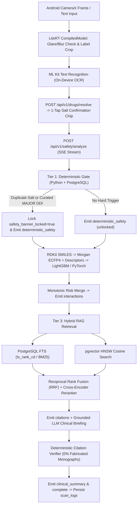

# PillScope Architecture

PillScope is a safety-first Android + Python AI Medication Safety & Drug-Interaction (DDI) Copilot. This document defines the monorepo layout, PostgreSQL + `pgvector` schema, REST/SSE API contracts, and on-device + server ML/RAG data flow.

---

## 1. Core Safety Invariant

**Safety-First Determinism:** Duplicate active-salt detection and curated `MAJOR` DDI checks run deterministically in Python + PostgreSQL **before** and **independently of** ML inference or LLM synthesis.

- If any duplicate active salt or curated `MAJOR` DDI is detected, `safety_banner_locked = true` and `overall_risk = "MAJOR"` are locked in code and emitted in the very first SSE event.
- Downstream ML scoring may escalate an unmapped pair's risk level, but neither ML nor the LLM can ever downgrade a deterministic `MAJOR` alert or unlock `safety_banner_locked`.
- Every clinical monograph citation returned to the client must pass a deterministic Citation Verifier against `monograph_chunks` (0% fabricated monographs).

---

## 2. Monorepo Directory Tree

```text
PillScope/
├── ARCHITECTURE.md
├── pyproject.toml                  # Python 3.12 workspace dependencies, Ruff, pytest, mypy
├── uv.lock                         # Reproducible Python 3.12 lockfile (core, ml, eval, dev)
├── .python-version                 # Pins Python 3.12
├── .env.example                    # Environment configuration template (no secrets)
├── .gitignore
├── .github/
│   └── workflows/
│       └── ci.yml                  # Lint (Ruff), tests (pytest), Docker Compose validation
├── backend/
│   ├── app/
│   │   ├── __init__.py
│   │   ├── core/                   # Settings, JWT/Argon2 auth, structured logging, OTel (Phase 1)
│   │   ├── db/                     # Async SQLAlchemy 2.0 models, session, Alembic migrations (Phase 1)
│   │   ├── schemas/                # Strict Pydantic v2 API, domain, and SSE event models (Phase 1+)
│   │   ├── api/                    # Versioned FastAPI REST & SSE routers /api/v1/* (Phase 1+)
│   │   ├── services/               # Brand resolver, deterministic DDI, ML scorer, hybrid RAG, LLM (Phase 2-4)
│   │   └── workers/                # ARQ worker config & async ingestion/indexing tasks (Phase 2+)
│   ├── scripts/                    # Dataset download & ingestion CLIs (DDInter, openFDA, DailyMed, IN brands)
│   └── tests/                      # Unit, integration, contract, and safety-gate pytest suites
├── ml/
│   ├── ddi/                        # RDKit featurization, LightGBM/PyTorch training, MLflow logging (Phase 3)
│   ├── edge_vision/                # Glare/blur quality + label cropper training & LiteRT export (Phase 3)
│   └── artifacts/                  # Local model checkpoints & LiteRT binaries (git-ignored)
├── eval/
│   ├── datasets/                   # Gold DDI/RAG benchmarks & safety regression fixtures (Phase 5)
│   ├── benchmarks/                 # Macro-F1, PR-AUC, and 100% Major DDI recall gate (Phase 5)
│   ├── rag_eval/                   # DeepEval/RAGAS faithfulness & citation verifier suite (Phase 5)
│   └── tracing/                    # OpenTelemetry & Langfuse instrumentation hooks (Phase 5)
├── android/
│   └── app/
│       └── src/
│           ├── main/
│           │   ├── java/com/pillscope/app/
│           │   │   ├── di/         # Hilt dependency injection modules (Phase 6)
│           │   │   ├── data/       # Room DB (offline cabinet/briefings), Retrofit + OkHttp SSE (Phase 6)
│           │   │   ├── ml/         # CameraX, LiteRT CompiledModel quality/crop, ML Kit OCR (Phase 6)
│           │   │   └── ui/         # Jetpack Compose M3 screens, 1-tap salt chips, locked banner (Phase 6)
│           │   └── assets/         # Bundled LiteRT vision models
│           └── test/               # Android JVM unit tests
└── infra/
    ├── docker-compose.yml          # PostgreSQL (pgvector), Redis, FastAPI API, ARQ worker
    ├── docker/
    │   └── backend.Dockerfile      # Multi-stage Python 3.12 + uv production image
    └── postgres/
        └── init/
            └── 01_extensions.sql   # Enables pgcrypto, vector (pgvector), and pg_trgm
```

---

## 3. PostgreSQL + pgvector Schema

Required PostgreSQL extensions: `pgcrypto`, `vector` (`pgvector`), and `pg_trgm`.

### 3.1 `users`

| Column | Type | Constraints / Notes |
| --- | --- | --- |
| `id` | `UUID` | `PRIMARY KEY DEFAULT gen_random_uuid()` |
| `email` | `VARCHAR(255)` | `NOT NULL UNIQUE` |
| `password_hash` | `TEXT` | `NOT NULL` (Argon2id hash) |
| `display_name` | `VARCHAR(120)` | Nullable |
| `is_active` | `BOOLEAN` | `NOT NULL DEFAULT TRUE` |
| `created_at` | `TIMESTAMPTZ` | `NOT NULL DEFAULT now()` |
| `updated_at` | `TIMESTAMPTZ` | `NOT NULL DEFAULT now()` |

### 3.2 `brand_salt_mappings`

Maps Indian and international branded medicines (e.g., `"Augmentin 625 Duo"`) to canonical generic salts and SMILES strings.

| Column | Type | Constraints / Notes |
| --- | --- | --- |
| `id` | `UUID` | `PRIMARY KEY DEFAULT gen_random_uuid()` |
| `brand_name` | `VARCHAR(255)` | `NOT NULL` (original display name) |
| `normalized_brand` | `VARCHAR(255)` | `NOT NULL` (lowercased, punctuation-normalized) |
| `manufacturer` | `VARCHAR(255)` | Nullable |
| `country_code` | `CHAR(2)` | `NOT NULL DEFAULT 'IN'` (`IN`, `US`, etc.) |
| `dosage_form` | `VARCHAR(64)` | `tablet`, `capsule`, `syrup`, `injection`, etc. |
| `generic_salts` | `JSONB` | `NOT NULL` — `[{"rxcui": "723", "canonical_salt": "amoxicillin", "strength_mg": 500.0}, ...]` |
| `canonical_salt_keys` | `TEXT[]` | `NOT NULL` — sorted lowercase canonical salt names for overlap queries |
| `smiles_map` | `JSONB` | `NOT NULL DEFAULT '{}'::jsonb` — `{canonical_salt: canonical_smiles}` |
| `source` | `VARCHAR(64)` | `NOT NULL` (`india_drug_catalog`, `openfda`, `dailymed`, `rxnorm`) |
| `source_id` | `VARCHAR(128)` | External catalog identifier |
| `created_at` | `TIMESTAMPTZ` | `NOT NULL DEFAULT now()` |
| `updated_at` | `TIMESTAMPTZ` | `NOT NULL DEFAULT now()` |

**Indexes & Constraints:**
- `UNIQUE (normalized_brand, country_code, COALESCE(dosage_form, ''))`
- `GIN (normalized_brand gin_trgm_ops)` — fuzzy matching for noisy OCR & Indian brands
- `GIN (canonical_salt_keys)` — reverse lookup by generic salt

### 3.3 `medications`

User's active and historical medication cabinet (synced with Android Room DB).

| Column | Type | Constraints / Notes |
| --- | --- | --- |
| `id` | `UUID` | `PRIMARY KEY DEFAULT gen_random_uuid()` |
| `user_id` | `UUID` | `NOT NULL REFERENCES users(id) ON DELETE CASCADE` |
| `brand_mapping_id` | `UUID` | `REFERENCES brand_salt_mappings(id) ON DELETE SET NULL` |
| `display_name` | `VARCHAR(255)` | `NOT NULL` |
| `generic_salts` | `JSONB` | `NOT NULL` — snapshot of resolved salts & strengths |
| `canonical_salt_keys` | `TEXT[]` | `NOT NULL` — denormalized canonical salt array |
| `dosage_schedule` | `VARCHAR(120)` | Nullable (e.g., `"1 tablet BID"`) |
| `is_active` | `BOOLEAN` | `NOT NULL DEFAULT TRUE` |
| `started_at` | `TIMESTAMPTZ` | Nullable |
| `ended_at` | `TIMESTAMPTZ` | Nullable |
| `created_at` | `TIMESTAMPTZ` | `NOT NULL DEFAULT now()` |
| `updated_at` | `TIMESTAMPTZ` | `NOT NULL DEFAULT now()` |

**Indexes:**
- `BTREE (user_id, is_active)`
- `GIN (canonical_salt_keys)`

### 3.4 `ddi_pairs`

Curated deterministic pairwise DDI knowledge base ingested from DDInter 2.0 and DailyMed/openFDA.

| Column | Type | Constraints / Notes |
| --- | --- | --- |
| `id` | `UUID` | `PRIMARY KEY DEFAULT gen_random_uuid()` |
| `salt_a` | `VARCHAR(160)` | `NOT NULL` — canonical lowercase salt (`salt_a < salt_b`) |
| `salt_b` | `VARCHAR(160)` | `NOT NULL` — canonical lowercase salt (`salt_a < salt_b`) |
| `salt_a_smiles` | `TEXT` | Canonical RDKit SMILES |
| `salt_b_smiles` | `TEXT` | Canonical RDKit SMILES |
| `severity` | `VARCHAR(16)` | `NOT NULL CHECK (severity IN ('MAJOR', 'MODERATE', 'MINOR', 'UNKNOWN'))` |
| `mechanism` | `TEXT` | `NOT NULL` |
| `clinical_effect` | `TEXT` | `NOT NULL` |
| `management` | `TEXT` | `NOT NULL` |
| `evidence_level` | `VARCHAR(32)` | `NOT NULL DEFAULT 'CURATED'` (`CURATED`, `LABEL`, `LITERATURE`) |
| `sources` | `TEXT[]` | `NOT NULL` (e.g., `{'ddinter_2', 'dailymed'}`) |
| `source_record_ids` | `JSONB` | `NOT NULL DEFAULT '{}'::jsonb` |
| `is_hard_safety_override` | `BOOLEAN` | `GENERATED ALWAYS AS (severity = 'MAJOR') STORED` |
| `updated_at` | `TIMESTAMPTZ` | `NOT NULL DEFAULT now()` |

**Indexes & Constraints:**
- `CHECK (salt_a < salt_b)` — canonical lexicographical pair ordering prevents duplicate mirror rows
- `UNIQUE (salt_a, salt_b)` — deterministic priority merge retains highest curated severity
- `BTREE (salt_a, salt_b)`
- Partial index `BTREE (salt_a, salt_b) WHERE severity = 'MAJOR'`

### 3.5 `monograph_chunks`

Structured openFDA / DailyMed SPL sections indexed for Hybrid RAG (PostgreSQL full-text + `pgvector` HNSW).

| Column | Type | Constraints / Notes |
| --- | --- | --- |
| `id` | `UUID` | `PRIMARY KEY DEFAULT gen_random_uuid()` |
| `set_id` | `VARCHAR(128)` | `NOT NULL` (DailyMed / openFDA SPL `set_id`) |
| `document_version` | `VARCHAR(32)` | SPL document version |
| `canonical_salt` | `VARCHAR(160)` | `NOT NULL` |
| `loinc_section_code` | `VARCHAR(32)` | `NOT NULL` (e.g., `34073-7` Drug Interactions, `34070-3` Contraindications) |
| `section_title` | `VARCHAR(160)` | `NOT NULL` |
| `chunk_index` | `INTEGER` | `NOT NULL` |
| `content` | `TEXT` | `NOT NULL` |
| `content_sha256` | `CHAR(64)` | `NOT NULL` |
| `source_url` | `TEXT` | `NOT NULL` |
| `fts_vector` | `TSVECTOR` | `GENERATED ALWAYS AS (to_tsvector('english', coalesce(canonical_salt, '') || ' ' || coalesce(section_title, '') || ' ' || content)) STORED` |
| `embedding` | `VECTOR(768)` | `NOT NULL` (dimension configured via `EMBEDDING_DIM`, default 768) |
| `metadata` | `JSONB` | `NOT NULL DEFAULT '{}'::jsonb` |
| `created_at` | `TIMESTAMPTZ` | `NOT NULL DEFAULT now()` |

**Indexes & Constraints:**
- `UNIQUE (set_id, loinc_section_code, chunk_index)`
- `BTREE (canonical_salt, loinc_section_code)`
- `GIN (fts_vector)` — PostgreSQL full-text retrieval (`ts_rank_cd`)
- `HNSW (embedding vector_cosine_ops) WITH (m = 16, ef_construction = 64)` — dense semantic retrieval

### 3.6 `scan_logs`

Immutable audit trail for every safety analysis run, capturing inputs, cabinet snapshot, safety decisions, verified citations, and trace correlation.

| Column | Type | Constraints / Notes |
| --- | --- | --- |
| `id` | `UUID` | `PRIMARY KEY DEFAULT gen_random_uuid()` |
| `user_id` | `UUID` | `NOT NULL REFERENCES users(id) ON DELETE CASCADE` |
| `input_mode` | `VARCHAR(16)` | `NOT NULL CHECK (input_mode IN ('CAMERA_OCR', 'MANUAL_TEXT', 'BARCODE'))` |
| `raw_ocr_text` | `TEXT` | Nullable |
| `edge_quality_metrics` | `JSONB` | Nullable (`blur_score`, `glare_ratio`, `crop_confidence`) |
| `submitted_query` | `VARCHAR(255)` | `NOT NULL` |
| `resolved_salts` | `JSONB` | `NOT NULL` |
| `cabinet_snapshot` | `JSONB` | `NOT NULL` — active cabinet salts at scan time |
| `overall_risk` | `VARCHAR(16)` | `NOT NULL CHECK (overall_risk IN ('MAJOR', 'MODERATE', 'MINOR', 'NONE'))` |
| `safety_banner_locked` | `BOOLEAN` | `NOT NULL DEFAULT FALSE` |
| `deterministic_alerts` | `JSONB` | `NOT NULL DEFAULT '[]'::jsonb` |
| `duplicate_salts` | `JSONB` | `NOT NULL DEFAULT '[]'::jsonb` |
| `interactions` | `JSONB` | `NOT NULL DEFAULT '[]'::jsonb` |
| `clinical_summary` | `JSONB` | Nullable (populated after verified briefing) |
| `citations` | `JSONB` | `NOT NULL DEFAULT '[]'::jsonb` |
| `citation_verified` | `BOOLEAN` | `NOT NULL DEFAULT FALSE` |
| `trace_id` | `VARCHAR(64)` | OpenTelemetry / Langfuse trace ID |
| `latency_ms` | `INTEGER` | End-to-end stream latency |
| `created_at` | `TIMESTAMPTZ` | `NOT NULL DEFAULT now()` |

**Indexes:**
- `BTREE (user_id, created_at DESC)`
- `BTREE (overall_risk, created_at DESC)`

---

## 4. API Endpoints & SSE Event Contract

All application routes are versioned under `/api/v1` and protected by Bearer JWT authentication unless explicitly marked public.

### 4.1 REST Endpoints

| Method | Path | Auth | Purpose |
| --- | --- | --- | --- |
| `GET` | `/healthz` | Public | Process liveness check |
| `GET` | `/readyz` | Public | Dependency readiness check (PostgreSQL + `pgvector`, Redis) |
| `POST` | `/api/v1/auth/register` | Public | Register user, return access & refresh JWTs |
| `POST` | `/api/v1/auth/login` | Public | Authenticate credentials, return access & refresh JWTs |
| `POST` | `/api/v1/auth/refresh` | Refresh JWT | Rotate access & refresh tokens |
| `GET` | `/api/v1/auth/me` | Bearer JWT | Current authenticated user profile |
| `POST` | `/api/v1/drugs/resolve` | Bearer JWT | Map raw OCR text or brand name to ranked generic salt candidates for Android 1-tap confirmation chips |
| `GET` | `/api/v1/drugs/search` | Bearer JWT | Fuzzy trigram autocomplete (`?q=&country=IN&limit=10`) |
| `GET` | `/api/v1/cabinet/medications` | Bearer JWT | List user's active/historical cabinet medications |
| `POST` | `/api/v1/cabinet/medications` | Bearer JWT | Add confirmed drug to medication cabinet |
| `PATCH` | `/api/v1/cabinet/medications/{id}` | Bearer JWT | Update dosage schedule or toggle `is_active` |
| `DELETE` | `/api/v1/cabinet/medications/{id}` | Bearer JWT | Remove medication from cabinet |
| `POST` | `/api/v1/scans/analyze` | Bearer JWT | Run 3-tier safety pipeline against active cabinet; returns `text/event-stream` (SSE) |
| `GET` | `/api/v1/scans` | Bearer JWT | Paginated scan history for offline Room caching |
| `GET` | `/api/v1/scans/{scan_id}` | Bearer JWT | Retrieve full persisted scan briefing and citations |
| `POST` | `/api/v1/internal/jobs/ingest` | Admin Key | Enqueue ARQ background dataset ingestion / re-indexing job |

### 4.2 SSE Event Contract (`POST /api/v1/scans/analyze`)

**Request Body (`SafetyAnalyzeRequest`):**
```json
{
  "input_mode": "CAMERA_OCR",
  "submitted_query": "Augmentin 625 Duo",
  "confirmed_salts": ["amoxicillin", "clavulanic acid"],
  "raw_ocr_text": "AUGMENTIN 625 DUO Amoxycillin 500mg Clavulanic Acid 125mg",
  "edge_quality_metrics": {
    "blur_score": 0.91,
    "glare_ratio": 0.03,
    "crop_confidence": 0.96
  }
}
```

**Streamed Events (`Content-Type: text/event-stream`):**
Events are emitted sequentially with monotonic `id` headers (`1`, `2`, ...) and strict Pydantic v2 JSON payloads:

1. **`deterministic_safety`** *(Tier 1 hard safety gate — emitted first before ML or LLM execution)*
   ```json
   {
     "scan_id": "uuid",
     "overall_risk": "MAJOR | MODERATE | MINOR | NONE",
     "safety_banner_locked": true,
     "duplicate_salts": [
       {
         "canonical_salt": "amoxicillin",
         "existing_medication_id": "uuid",
         "existing_display_name": "Mox 500 Capsule",
         "reason": "DUPLICATE_ACTIVE_INGREDIENT"
       }
     ],
     "deterministic_alerts": [
       {
         "rule_id": "ddi_pairs:uuid",
         "salt_a": "amoxicillin",
         "salt_b": "warfarin",
         "severity": "MAJOR",
         "mechanism": "...",
         "management": "...",
         "source": "ddinter_2"
       }
     ]
   }
   ```
2. **`interactions`** *(Tier 2 RDKit + LightGBM/PyTorch scoring merged with Tier 1 rules; `overall_risk` is monotonically non-decreasing and `safety_banner_locked` is sticky)*
   ```json
   {
     "scan_id": "uuid",
     "overall_risk": "MAJOR | MODERATE | MINOR | NONE",
     "safety_banner_locked": true,
     "interactions": [
       {
         "salt_a": "amoxicillin",
         "salt_b": "warfarin",
         "severity": "MAJOR",
         "confidence": 1.0,
         "source": "deterministic_db | ml_model | hybrid",
         "mechanism": "...",
         "management": "..."
       }
     ]
   }
   ```
3. **`citations`** *(Tier 3 Hybrid RAG + Cross-Encoder reranked openFDA/DailyMed provenance)*
   ```json
   {
     "scan_id": "uuid",
     "citations": [
       {
         "chunk_id": "uuid",
         "set_id": "spl-set-id",
         "canonical_salt": "warfarin",
         "section_title": "DRUG INTERACTIONS",
         "loinc_section_code": "34073-7",
         "excerpt": "...",
         "source_url": "https://dailymed.nlm.nih.gov/...",
         "rerank_score": 0.94
       }
     ]
   }
   ```
4. **`summary_delta`** *(Optional incremental text tokens during LLM generation; UI never binds banner state to this event)*
   ```json
   { "scan_id": "uuid", "delta": "..." }
   ```
5. **`clinical_summary`** *(Structured Pydantic v2 briefing validated by the deterministic Citation Verifier)*
   ```json
   {
     "scan_id": "uuid",
     "citation_verified": true,
     "clinical_summary": {
       "headline": "...",
       "patient_explanation": "...",
       "actionable_next_steps": ["..."],
       "cited_chunk_ids": ["uuid"],
       "disclaimer": "Informational safety check only; consult a licensed clinician or pharmacist."
     }
   }
   ```
6. **`complete`** *(Final canonical payload persisted to `scan_logs`)*
   Contains `scan_id`, `overall_risk`, `safety_banner_locked`, `deterministic_alerts`, `duplicate_salts`, `interactions`, `clinical_summary`, `citations`, `citation_verified`, and `latency_ms`.
7. **`error`** *(Structured failure frame; never overrides a previously locked `deterministic_safety` banner)*
   ```json
   { "scan_id": "uuid", "code": "RAG_TIMEOUT", "message": "...", "recoverable": true }
   ```

---

## 5. ML & Hybrid RAG Data Flow



### Key Pipeline Guarantees
- **On-Device Edge Vision (`ml/edge_vision/` -> `android/`):** Lightweight blur/glare classifier and label-region cropper exported to LiteRT (`.tflite` / `CompiledModel` API) filters unreadable captures before ML Kit OCR runs, keeping latency low and reducing brand misreads.
- **Pairwise Molecular DDI Model (`ml/ddi/`):** Trained on DDInter 2.0 + DailyMed DDI datasets using scaffold/drug-level splits (preventing data leakage), RDKit Morgan fingerprints + physicochemical descriptors, LightGBM + PyTorch MLP/GNN ensemble, tracked in MLflow, and gated in `eval/benchmarks/` on macro-F1, PR-AUC, and **100% recall on Major interactions** (combining deterministic lookup + calibrated ML thresholds).
- **Hybrid RAG & Provenance (`backend/app/services/` + `eval/rag_eval/`):** Combines exact drug-salt lexical matching (PostgreSQL `GIN(fts_vector)`) with semantic dense embeddings (`pgvector` HNSW), fused via RRF and reranked by a cross-encoder over official openFDA/DailyMed SPL sections (`34073-7`, `34070-3`, `43685-7`). Every `cited_chunk_id` is verified against the retrieved set in Python before release.
- **Async Background Ingestion (`backend/app/workers/`):** Redis + ARQ workers execute idempotent ingestion pipelines for DDInter 2.0, openFDA/DailyMed monographs, and Indian brand-salt catalogs without blocking interactive SSE requests.
