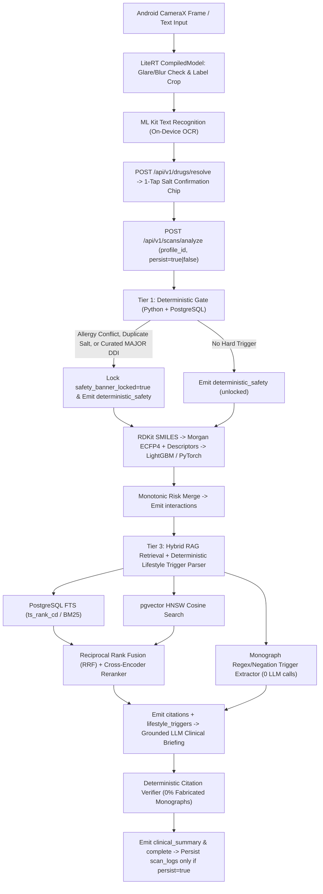

# PillScope Architecture

PillScope is a safety-first Android + Python AI Medication Safety & Drug-Interaction (DDI) Copilot. This document defines the monorepo layout, PostgreSQL + `pgvector` schema, REST/SSE API contracts, deterministic clinical safety engines, and on-device + server ML/RAG data flow.

---

## 1. Core Safety Invariant

**Safety-First Determinism:** Documented profile allergy checks, duplicate active-salt detection, and curated `MAJOR` DDI checks run deterministically in Python + PostgreSQL **before** and **independently of** ML inference or LLM synthesis.

- If any profile allergy conflict (direct salt or drug-class match), duplicate active salt, or curated `MAJOR` DDI is detected, `safety_banner_locked = true` and `overall_risk = "MAJOR"` are locked in code and emitted in the very first SSE event (`deterministic_safety`).
- Downstream ML scoring may escalate an unmapped pair's risk level, but neither ML nor the LLM can ever downgrade a deterministic `MAJOR` alert or unlock `safety_banner_locked`.
- Every clinical monograph citation returned to the client must pass a deterministic Citation Verifier against `monograph_chunks` (0% fabricated monographs).
- Food, alcohol, and lifestyle trigger badges are extracted deterministically from stored openFDA/DailyMed monograph chunks with zero LLM calls.
- Daily dose scheduling is computed deterministically via an exact constraint solver over pharmacological absorption-separation rules, explicitly flagging unresolvable `MAJOR` DDI and duplicate-salt clashes that timing alone cannot resolve.

---

## 2. Monorepo Directory Tree

```text
PillScope/
├── ARCHITECTURE.md
├── pyproject.toml                  # Python 3.12 workspace dependencies, Ruff, pytest, mypy
├── uv.lock                         # Reproducible Python 3.12 lockfile (core, ml, eval, dev)
├── .python-version                 # Pins Python 3.12
├── .env.example                    # Environment configuration template (no secrets)
├── .gitignore
├── .github/
│   └── workflows/
│       └── ci.yml                  # Lint (Ruff), tests (pytest), Docker Compose validation
├── backend/
│   ├── app/
│   │   ├── __init__.py
│   │   ├── core/                   # Settings, JWT/Argon2 auth, structured logging, OTel
│   │   ├── db/                     # Async SQLAlchemy 2.0 models, session, Alembic migrations (0001-0004)
│   │   ├── schemas/                # Strict Pydantic v2 API, profile, schedule, lifestyle, recall & SSE models
│   │   ├── api/                    # Versioned FastAPI REST & SSE routers /api/v1/*
│   │   ├── services/               # Brand resolver, allergy checker, deterministic DDI, dose scheduler, lifestyle triggers, FDA recall watchdog, ML scorer, hybrid RAG, LLM
│   │   └── workers/                # ARQ worker config, scheduled FDA recall sync cron, monograph ingestion tasks
│   ├── scripts/                    # Dataset download & ingestion CLIs (DDInter, openFDA, DailyMed, IN brands)
│   └── tests/                      # Unit, integration, contract, and safety-gate pytest suites
├── ml/
│   ├── ddi/                        # RDKit featurization, LightGBM/PyTorch training, MLflow logging
│   ├── edge_vision/                # Glare/blur quality + label cropper training & LiteRT export
│   └── artifacts/                  # Local model checkpoints & LiteRT binaries (git-ignored)
├── eval/
│   ├── datasets/                   # Gold DDI/RAG benchmarks & safety regression fixtures
│   ├── benchmarks/                 # Macro-F1, PR-AUC, and 100% Major DDI recall gate
│   ├── rag_eval/                   # DeepEval/RAGAS faithfulness & citation verifier suite
│   └── tracing/                    # OpenTelemetry & Langfuse instrumentation hooks
├── android/
│   └── app/
│       └── src/
│           ├── main/
│           │   ├── java/com/pillscope/app/
│           │   │   ├── di/         # Hilt dependency injection modules
│           │   │   ├── data/       # Room DB (offline cabinet/briefings), Retrofit + OkHttp SSE
│           │   │   ├── ml/         # CameraX, LiteRT CompiledModel quality/crop, ML Kit OCR
│           │   │   └── ui/         # Jetpack Compose M3 screens, 1-tap salt chips, locked banner
│           │   └── assets/         # Bundled LiteRT vision models
│           └── test/               # Android JVM unit tests
└── infra/
    ├── docker-compose.yml          # PostgreSQL (pgvector), Redis, FastAPI API, ARQ worker
    ├── docker/
    │   └── backend.Dockerfile      # Multi-stage Python 3.12 + uv production image
    └── postgres/
        └── init/
            └── 01_extensions.sql   # Enables pgcrypto, vector (pgvector), and pg_trgm
```

---

## 3. PostgreSQL + pgvector Schema

Required PostgreSQL extensions: `pgcrypto`, `vector` (`pgvector`), and `pg_trgm`.

### 3.1 `users`

| Column | Type | Constraints / Notes |
| --- | --- | --- |
| `id` | `UUID` | `PRIMARY KEY DEFAULT gen_random_uuid()` |
| `email` | `VARCHAR(255)` | `NOT NULL UNIQUE` |
| `password_hash` | `TEXT` | `NOT NULL` (Argon2id hash) |
| `display_name` | `VARCHAR(120)` | Nullable |
| `is_active` | `BOOLEAN` | `NOT NULL DEFAULT TRUE` |
| `created_at` | `TIMESTAMPTZ` | `NOT NULL DEFAULT now()` |
| `updated_at` | `TIMESTAMPTZ` | `NOT NULL DEFAULT now()` |

### 3.2 `profiles`

Per-person medication cabinet and allergy profile belonging to an authenticated user (e.g., self, parent, child, spouse). Registration automatically provisions a default `is_default = TRUE` profile, and migration `0003_multi_profile_cabinets` backfills existing `medications` and `scan_logs` into each user's default profile.

| Column | Type | Constraints / Notes |
| --- | --- | --- |
| `id` | `UUID` | `PRIMARY KEY DEFAULT gen_random_uuid()` |
| `user_id` | `UUID` | `NOT NULL REFERENCES users(id) ON DELETE CASCADE` |
| `name` | `VARCHAR(120)` | `NOT NULL` |
| `relationship` | `VARCHAR(64)` | `NOT NULL DEFAULT 'self'` (`self`, `parent`, `child`, `spouse`, `other`, etc.) |
| `allergies_json` | `JSONB` | `NOT NULL DEFAULT '[]'::jsonb` — list of allergen strings or `{allergen, reaction?, severity?}` objects |
| `notes` | `TEXT` | Nullable |
| `is_default` | `BOOLEAN` | `NOT NULL DEFAULT FALSE` |
| `created_at` | `TIMESTAMPTZ` | `NOT NULL DEFAULT now()` |
| `updated_at` | `TIMESTAMPTZ` | `NOT NULL DEFAULT now()` |

**Indexes & Constraints:**
- `BTREE (user_id)`
- Partial unique index `uq_profiles_user_default (user_id) WHERE is_default = true` — enforces at most one default profile per user.

### 3.3 `brand_salt_mappings`

Maps Indian and international branded medicines (e.g., `"Augmentin 625 Duo"`) to canonical generic salts and SMILES strings.

| Column | Type | Constraints / Notes |
| --- | --- | --- |
| `id` | `UUID` | `PRIMARY KEY DEFAULT gen_random_uuid()` |
| `brand_name` | `VARCHAR(255)` | `NOT NULL` (original display name) |
| `normalized_brand` | `VARCHAR(255)` | `NOT NULL` (lowercased, punctuation-normalized) |
| `manufacturer` | `VARCHAR(255)` | Nullable |
| `country_code` | `CHAR(2)` | `NOT NULL DEFAULT 'IN'` (`IN`, `US`, etc.) |
| `dosage_form` | `VARCHAR(64)` | `tablet`, `capsule`, `syrup`, `injection`, etc. |
| `generic_salts` | `JSONB` | `NOT NULL` — `[{"rxcui": "723", "canonical_salt": "amoxicillin", "strength_mg": 500.0}, ...]` |
| `canonical_salt_keys` | `TEXT[]` | `NOT NULL` — sorted lowercase canonical salt names for overlap queries |
| `smiles_map` | `JSONB` | `NOT NULL DEFAULT '{}'::jsonb` — `{canonical_salt: canonical_smiles}` |
| `source` | `VARCHAR(64)` | `NOT NULL` (`india_drug_catalog`, `openfda`, `dailymed`, `rxnorm`) |
| `source_id` | `VARCHAR(128)` | External catalog identifier |
| `created_at` | `TIMESTAMPTZ` | `NOT NULL DEFAULT now()` |
| `updated_at` | `TIMESTAMPTZ` | `NOT NULL DEFAULT now()` |

**Indexes & Constraints:**
- `UNIQUE (normalized_brand, country_code, COALESCE(dosage_form, ''))`
- `GIN (normalized_brand gin_trgm_ops)` — fuzzy matching for noisy OCR & Indian brands
- `GIN (canonical_salt_keys)` — reverse lookup by generic salt

### 3.4 `medications`

Profile-scoped active and historical medication cabinet (synced with Android Room DB).

| Column | Type | Constraints / Notes |
| --- | --- | --- |
| `id` | `UUID` | `PRIMARY KEY DEFAULT gen_random_uuid()` |
| `user_id` | `UUID` | `NOT NULL REFERENCES users(id) ON DELETE CASCADE` |
| `profile_id` | `UUID` | `NOT NULL REFERENCES profiles(id) ON DELETE CASCADE` |
| `brand_mapping_id` | `UUID` | `REFERENCES brand_salt_mappings(id) ON DELETE SET NULL` |
| `display_name` | `VARCHAR(255)` | `NOT NULL` |
| `generic_salts` | `JSONB` | `NOT NULL` — snapshot of resolved salts & strengths |
| `canonical_salt_keys` | `TEXT[]` | `NOT NULL` — denormalized canonical salt array |
| `dosage_schedule` | `VARCHAR(120)` | Nullable (e.g., `"1 tablet BID"`) |
| `is_active` | `BOOLEAN` | `NOT NULL DEFAULT TRUE` |
| `started_at` | `TIMESTAMPTZ` | Nullable |
| `ended_at` | `TIMESTAMPTZ` | Nullable |
| `created_at` | `TIMESTAMPTZ` | `NOT NULL DEFAULT now()` |
| `updated_at` | `TIMESTAMPTZ` | `NOT NULL DEFAULT now()` |

**Indexes:**
- `BTREE (user_id, is_active)`
- `BTREE (profile_id, is_active)`
- `GIN (canonical_salt_keys)`

### 3.5 `ddi_pairs`

Curated deterministic pairwise DDI knowledge base ingested from DDInter 2.0 and DailyMed/openFDA.

| Column | Type | Constraints / Notes |
| --- | --- | --- |
| `id` | `UUID` | `PRIMARY KEY DEFAULT gen_random_uuid()` |
| `salt_a` | `VARCHAR(160)` | `NOT NULL` — canonical lowercase salt (`(salt_a COLLATE "C") < (salt_b COLLATE "C")`) |
| `salt_b` | `VARCHAR(160)` | `NOT NULL` — canonical lowercase salt |
| `salt_a_smiles` | `TEXT` | Canonical RDKit SMILES |
| `salt_b_smiles` | `TEXT` | Canonical RDKit SMILES |
| `severity` | `VARCHAR(16)` | `NOT NULL CHECK (severity IN ('MAJOR', 'MODERATE', 'MINOR', 'UNKNOWN'))` |
| `mechanism` | `TEXT` | `NOT NULL` |
| `clinical_effect` | `TEXT` | `NOT NULL` |
| `management` | `TEXT` | `NOT NULL` |
| `evidence_level` | `VARCHAR(32)` | `NOT NULL DEFAULT 'CURATED'` (`CURATED`, `LABEL`, `LITERATURE`) |
| `sources` | `TEXT[]` | `NOT NULL` (e.g., `{'ddinter_2', 'dailymed'}`) |
| `source_record_ids` | `JSONB` | `NOT NULL DEFAULT '{}'::jsonb` |
| `is_hard_safety_override` | `BOOLEAN` | `GENERATED ALWAYS AS (severity = 'MAJOR') STORED` |
| `updated_at` | `TIMESTAMPTZ` | `NOT NULL DEFAULT now()` |

**Indexes & Constraints:**
- `CHECK ((salt_a COLLATE "C") < (salt_b COLLATE "C"))` — canonical lexicographical pair ordering
- `UNIQUE (salt_a, salt_b)`
- `BTREE (salt_a, salt_b)`
- Partial index `BTREE (salt_a, salt_b) WHERE severity = 'MAJOR'`

### 3.6 `monograph_chunks`

Structured openFDA / DailyMed SPL sections (`drug_interactions` `34073-7`, `warnings` `43685-7`, `dosage_and_administration` `34068-7`, `contraindications` `34070-3`, `precautions` `42232-9`) indexed for Hybrid RAG and deterministic lifestyle trigger extraction.

| Column | Type | Constraints / Notes |
| --- | --- | --- |
| `id` | `UUID` | `PRIMARY KEY DEFAULT gen_random_uuid()` |
| `set_id` | `VARCHAR(128)` | `NOT NULL` (DailyMed / openFDA SPL `set_id`) |
| `document_version` | `VARCHAR(32)` | SPL document version |
| `canonical_salt` | `VARCHAR(160)` | `NOT NULL` |
| `loinc_section_code` | `VARCHAR(32)` | `NOT NULL` (`34073-7`, `43685-7`, `34068-7`, `34070-3`, `42232-9`) |
| `section_title` | `VARCHAR(160)` | `NOT NULL` |
| `chunk_index` | `INTEGER` | `NOT NULL` |
| `content` | `TEXT` | `NOT NULL` |
| `content_sha256` | `CHAR(64)` | `NOT NULL` |
| `source_url` | `TEXT` | `NOT NULL` |
| `fts_vector` | `TSVECTOR` | `GENERATED ALWAYS AS (to_tsvector('english', coalesce(canonical_salt, '') || ' ' || coalesce(section_title, '') || ' ' || content)) STORED` |
| `embedding` | `VECTOR(768)` | `NOT NULL` (dimension configured via `EMBEDDING_DIM`, default 768) |
| `metadata` | `JSONB` | `NOT NULL DEFAULT '{}'::jsonb` |
| `created_at` | `TIMESTAMPTZ` | `NOT NULL DEFAULT now()` |

### 3.7 `scan_logs`

Immutable audit trail for persisted safety analysis runs (`persist=true`). Ephemeral "Check Before Buying" sandbox scans (`persist=false`) do not insert rows into `scan_logs` or `medications`.

| Column | Type | Constraints / Notes |
| --- | --- | --- |
| `id` | `UUID` | `PRIMARY KEY DEFAULT gen_random_uuid()` |
| `user_id` | `UUID` | `NOT NULL REFERENCES users(id) ON DELETE CASCADE` |
| `profile_id` | `UUID` | `NOT NULL REFERENCES profiles(id) ON DELETE CASCADE` |
| `input_mode` | `VARCHAR(16)` | `NOT NULL CHECK (input_mode IN ('CAMERA_OCR', 'MANUAL_TEXT', 'BARCODE'))` |
| `raw_ocr_text` | `TEXT` | Nullable |
| `edge_quality_metrics` | `JSONB` | Nullable (`blur_score`, `glare_ratio`, `crop_confidence`) |
| `submitted_query` | `VARCHAR(255)` | `NOT NULL` |
| `resolved_salts` | `JSONB` | `NOT NULL` |
| `cabinet_snapshot` | `JSONB` | `NOT NULL` — active profile cabinet salts at scan time |
| `overall_risk` | `VARCHAR(16)` | `NOT NULL CHECK (overall_risk IN ('MAJOR', 'MODERATE', 'MINOR', 'NONE'))` |
| `safety_banner_locked` | `BOOLEAN` | `NOT NULL DEFAULT FALSE` |
| `deterministic_alerts` | `JSONB` | `NOT NULL DEFAULT '[]'::jsonb` |
| `duplicate_salts` | `JSONB` | `NOT NULL DEFAULT '[]'::jsonb` |
| `allergy_alerts` | `JSONB` | `NOT NULL DEFAULT '[]'::jsonb` |
| `lifestyle_triggers` | `JSONB` | `NOT NULL DEFAULT '[]'::jsonb` |
| `interactions` | `JSONB` | `NOT NULL DEFAULT '[]'::jsonb` |
| `clinical_summary` | `JSONB` | Nullable |
| `citations` | `JSONB` | `NOT NULL DEFAULT '[]'::jsonb` |
| `citation_verified` | `BOOLEAN` | `NOT NULL DEFAULT FALSE` |
| `trace_id` | `VARCHAR(64)` | OpenTelemetry / Langfuse trace ID |
| `latency_ms` | `INTEGER` | End-to-end stream latency |
| `created_at` | `TIMESTAMPTZ` | `NOT NULL DEFAULT now()` |

**Indexes:**
- `BTREE (user_id, created_at DESC)`
- `BTREE (profile_id, created_at DESC)`
- `BTREE (overall_risk, created_at DESC)`

### 3.8 `recall_alerts`

US FDA Drug Recall Enforcement dataset ingested via ARQ scheduled sync (`https://api.fda.gov/drug/enforcement.json`) or bulk JSON/ZIP files (`0004_recall_alerts`).

| Column | Type | Constraints / Notes |
| --- | --- | --- |
| `id` | `UUID` | `PRIMARY KEY DEFAULT gen_random_uuid()` |
| `recall_number` | `VARCHAR(64)` | `NOT NULL UNIQUE` |
| `event_id` | `VARCHAR(64)` | Nullable |
| `status` | `VARCHAR(32)` | `NOT NULL` (`Ongoing`, `Pending`, `Completed`, `Terminated`) |
| `classification` | `VARCHAR(16)` | `NOT NULL CHECK (classification IN ('Class I', 'Class II', 'Class III'))` |
| `recalling_firm` | `VARCHAR(255)` | Nullable |
| `product_description` | `TEXT` | `NOT NULL` |
| `reason_for_recall` | `TEXT` | `NOT NULL` |
| `distribution_pattern` | `TEXT` | Nullable |
| `code_info` | `TEXT` | Nullable |
| `voluntary_mandated` | `VARCHAR(128)` | Nullable |
| `report_date` | `VARCHAR(16)` | Nullable (`YYYYMMDD`) |
| `recall_initiation_date` | `VARCHAR(16)` | Nullable (`YYYYMMDD`) |
| `termination_date` | `VARCHAR(16)` | Nullable (`YYYYMMDD`) |
| `brand_names` | `TEXT[]` | `NOT NULL DEFAULT '{}'::text[]` — normalized brand variants |
| `generic_names` | `TEXT[]` | `NOT NULL DEFAULT '{}'::text[]` |
| `canonical_salt_keys` | `TEXT[]` | `NOT NULL DEFAULT '{}'::text[]` — canonical lowercase salt keys |
| `raw_payload` | `JSONB` | `NOT NULL DEFAULT '{}'::jsonb` |
| `source_url` | `TEXT` | `NOT NULL` |
| `ingested_at` | `TIMESTAMPTZ` | `NOT NULL DEFAULT now()` |
| `updated_at` | `TIMESTAMPTZ` | `NOT NULL DEFAULT now()` |

**Indexes:**
- `UNIQUE (recall_number)`
- `BTREE (status, classification)`
- `GIN (canonical_salt_keys)`
- `GIN (brand_names)`

---

## 4. API Endpoints & JSON / SSE Contracts

All application routes are versioned under `/api/v1` and protected by Bearer JWT authentication unless explicitly marked public.

### 4.1 REST Endpoints

| Method | Path | Auth | Purpose |
| --- | --- | --- | --- |
| `GET` | `/healthz` | Public | Process liveness check |
| `GET` | `/readyz` | Public | Dependency readiness check (PostgreSQL + `pgvector`, Redis) |
| `POST` | `/api/v1/auth/register` | Public | Register user, auto-create default profile, return access & refresh JWTs |
| `POST` | `/api/v1/auth/login` | Public | Authenticate credentials, return access & refresh JWTs |
| `POST` | `/api/v1/auth/refresh` | Refresh JWT | Rotate access & refresh tokens |
| `GET` | `/api/v1/auth/me` | Bearer JWT | Current authenticated user account |
| `GET` | `/api/v1/profiles` | Bearer JWT | List all profiles belonging to the authenticated user |
| `POST` | `/api/v1/profiles` | Bearer JWT | Create a new medication profile with allergy list and relationship |
| `GET` | `/api/v1/profiles/{profile_id}` | Bearer JWT | Retrieve a specific profile |
| `PATCH` | `/api/v1/profiles/{profile_id}` | Bearer JWT | Update profile metadata, `allergies_json`, or default status |
| `DELETE` | `/api/v1/profiles/{profile_id}` | Bearer JWT | Delete a non-default profile and its cabinet |
| `GET` | `/api/v1/profiles/{profile_id}/schedule` | Bearer JWT | Deterministic conflict-free daily dose schedule for the profile's active cabinet |
| `GET` | `/api/v1/profiles/{profile_id}/recalls` | Bearer JWT | Active Class I & II `US FDA Recall Alert` matches for the profile's cabinet |
| `POST` | `/api/v1/drugs/resolve` | Bearer JWT | Map raw OCR text or brand name to ranked generic salt candidates |
| `GET` | `/api/v1/drugs/search` | Bearer JWT | Fuzzy trigram autocomplete (`?q=&country=IN&limit=10`) |
| `GET` | `/api/v1/cabinet/medications` | Bearer JWT | List profile's medications (`?profile_id=&active_only=true`) with lifestyle triggers & recall flags |
| `GET` | `/api/v1/cabinet/medications/{id}` | Bearer JWT | Retrieve full medication detail including `lifestyle_triggers` and active US FDA recall flags |
| `POST` | `/api/v1/cabinet/medications` | Bearer JWT | Add confirmed drug to profile's cabinet with duplicate-salt and allergy checks |
| `PATCH` | `/api/v1/cabinet/medications/{id}` | Bearer JWT | Update dosage schedule or toggle `is_active` |
| `DELETE` | `/api/v1/cabinet/medications/{id}` | Bearer JWT | Remove medication from cabinet |
| `POST` | `/api/v1/cabinet/check-duplicates` | Bearer JWT | Deterministic duplicate-salt and allergy pre-check scoped to `profile_id` |
| `POST` | `/api/v1/scans/analyze` | Bearer JWT | Run 3-tier safety pipeline against `profile_id` (`persist=false` sandbox supported); returns `text/event-stream` |
| `GET` | `/api/v1/scans` | Bearer JWT | Paginated scan history (`?profile_id=&limit=20&offset=0`) |
| `GET` | `/api/v1/scans/{scan_id}` | Bearer JWT | Retrieve full persisted scan briefing and citations |
| `POST` | `/api/v1/internal/jobs/ingest` | Admin Key | Enqueue ARQ background monograph ingestion job |
| `POST` | `/api/v1/internal/jobs/sync-recalls` | Admin Key | Enqueue ARQ background openFDA Drug Recall Enforcement sync job |

### 4.2 Profile & Medication Detail JSON Contracts

**Profile (`ProfileResponse`):**
```json
{
  "id": "uuid",
  "user_id": "uuid",
  "name": "Mom",
  "relationship": "parent",
  "allergies_json": ["Penicillin", {"allergen": "NSAIDs", "reaction": "Asthma flare", "severity": "SEVERE"}],
  "notes": "Monitor thyroid timing",
  "is_default": false,
  "created_at": "2026-11-26T10:00:00Z",
  "updated_at": "2026-11-26T10:00:00Z"
}
```

**Medication Detail (`MedicationDetailResponse` / `MedicationResponse`):**
```json
{
  "id": "uuid",
  "user_id": "uuid",
  "profile_id": "uuid",
  "brand_mapping_id": "uuid",
  "display_name": "Warf 5 Tablet",
  "generic_salts": [{"canonical_salt": "warfarin", "strength_mg": 5.0, "strength_text": "5mg", "rxcui": null}],
  "canonical_salt_keys": ["warfarin"],
  "dosage_schedule": "1 tablet OD",
  "is_active": true,
  "started_at": null,
  "ended_at": null,
  "created_at": "2026-11-26T10:00:00Z",
  "updated_at": "2026-11-26T10:00:00Z",
  "lifestyle_triggers": [
    {
      "type": "ALCOHOL",
      "severity": "HIGH",
      "short_note": "Avoid excessive alcohol intake because ethanol alters warfarin metabolism and increases bleeding risk.",
      "source_section": "warnings"
    }
  ],
  "has_active_recall": false,
  "active_recalls": []
}
```

### 4.3 Daily Dose Schedule Contract (`GET /api/v1/profiles/{profile_id}/schedule`)

Returns a strict 5-slot chronological timeline (`Morning (Empty Stomach)`, `Morning (With Food)`, `Afternoon`, `Evening`, `Bedtime`):

```json
{
  "profile_id": "uuid",
  "profile_name": "Primary Profile",
  "safety_banner_locked": false,
  "slots": [
    {
      "slot": "Morning (Empty Stomach)",
      "recommended_time": "07:00",
      "medications": [
        {
          "medication_id": "uuid",
          "display_name": "Thyronorm 50mcg",
          "canonical_salt_keys": ["levothyroxine"],
          "dosage_schedule": "1 tablet OD",
          "slot": "Morning (Empty Stomach)",
          "recommended_time": "07:00",
          "dose_number": 1,
          "total_daily_doses": 1,
          "rationale": ["Levothyroxine/thyroid hormone is best absorbed on an empty stomach 30–60 minutes before breakfast."],
          "separation_notes": ["Spaced 6.0h from Ferrous Sulfate 325mg (requires >=4.0h): Separate levothyroxine from iron by at least 4 hours to prevent absorption loss."]
        }
      ]
    },
    { "slot": "Morning (With Food)", "recommended_time": "08:00", "medications": [] },
    { "slot": "Afternoon", "recommended_time": "13:00", "medications": [] },
    { "slot": "Evening", "recommended_time": "18:30", "medications": [] },
    { "slot": "Bedtime", "recommended_time": "22:00", "medications": [] }
  ],
  "applied_separations": [
    {
      "medication_a_id": "uuid",
      "medication_a_name": "Thyronorm 50mcg",
      "salt_a": "levothyroxine",
      "medication_b_id": "uuid",
      "medication_b_name": "Ferrous Sulfate 325mg",
      "salt_b": "ferrous sulfate",
      "min_separation_minutes": 240,
      "actual_separation_minutes": 360,
      "satisfied": true,
      "reason": "Separate levothyroxine from iron by at least 4 hours to prevent absorption loss."
    }
  ],
  "unresolvable_clashes": [
    {
      "medication_a_id": "uuid",
      "medication_a_name": "Ecosprin 75",
      "salt_a": "aspirin",
      "medication_b_id": "uuid",
      "medication_b_name": "Warf 5",
      "salt_b": "warfarin",
      "severity": "MAJOR",
      "clash_type": "MAJOR_DDI",
      "mechanism": "Additive antiplatelet and vitamin K antagonist anticoagulation.",
      "management": "Avoid concurrent use unless specifically supervised with frequent INR checks.",
      "reason": "MAJOR systemic drug-drug interaction (aspirin + warfarin): High risk of severe hemorrhage. Timing separation alone cannot resolve this clash."
    }
  ],
  "disclaimer": "Automated daily dose schedule for educational support only; confirm medication timing and interactions with a licensed pharmacist or clinician."
}
```

### 4.4 US FDA Recall Alert Contract (`GET /api/v1/profiles/{profile_id}/recalls`)

```json
{
  "profile_id": "uuid",
  "profile_name": "Primary Profile",
  "alert_label": "US FDA Recall Alert",
  "has_active_recalls": true,
  "total_matches": 1,
  "recalls": [
    {
      "alert_label": "US FDA Recall Alert",
      "jurisdiction": "US_FDA",
      "recall_id": "uuid",
      "recall_number": "D-0123-2026",
      "event_id": "94123",
      "classification": "Class I",
      "status": "Ongoing",
      "recalling_firm": "Example Pharma Inc.",
      "product_description": "Valsartan Tablets, USP 80 mg",
      "reason_for_recall": "Presence of N-nitrosodimethylamine (NDMA) impurity above acceptable intake limits.",
      "distribution_pattern": "Nationwide in the USA",
      "code_info": "Lot 2026A",
      "report_date": "20260215",
      "recall_initiation_date": "20260201",
      "source_url": "https://api.fda.gov/drug/enforcement.json?search=recall_number%3A%22D-0123-2026%22",
      "matched_medication_id": "uuid",
      "matched_medication_name": "Diovan 80 Tablet",
      "match_basis": "BRAND_AND_SALT",
      "matched_terms": ["diovan", "valsartan"]
    }
  ]
}
```

### 4.5 SSE Event Contract (`POST /api/v1/scans/analyze`)

**Request Body (`ScanAnalyzeRequest`):**
```json
{
  "profile_id": "uuid-optional-defaults-to-primary-profile",
  "persist": false,
  "input_mode": "CAMERA_OCR",
  "submitted_query": "Augmentin 625 Duo",
  "confirmed_salts": ["amoxicillin", "clavulanic acid"],
  "raw_ocr_text": "AUGMENTIN 625 DUO Amoxycillin 500mg Clavulanic Acid 125mg",
  "edge_quality_metrics": {
    "blur_score": 0.91,
    "glare_ratio": 0.03,
    "crop_confidence": 0.96
  }
}
```

When `persist = false` ("Check Before Buying" sandbox mode), the entire deterministic safety, allergy, duplicate-salt, ML DDI, Hybrid RAG, lifestyle-trigger, and verified clinical briefing pipeline executes against the selected profile's cabinet without writing to `medications` or `scan_logs`.

**Streamed Events (`Content-Type: text/event-stream`):**
Events are emitted sequentially with monotonic `id` headers (`1`, `2`, `3`, `4`, `5`) and strict Pydantic v2 JSON payloads:

1. **`deterministic_safety`** *(Tier 1 hard safety gate — emitted first before ML or LLM execution)*
   ```json
   {
     "scan_id": "uuid",
     "profile_id": "uuid",
     "persisted": true,
     "submitted_query": "Augmentin 625 Duo",
     "resolved_salts": ["amoxicillin", "clavulanic acid"],
     "overall_risk": "MAJOR | MODERATE | MINOR | NONE",
     "safety_banner_locked": true,
     "duplicate_salts": [
       {
         "canonical_salt": "amoxicillin",
         "existing_medication_id": "uuid",
         "existing_display_name": "Mox 500 Capsule",
         "reason": "DUPLICATE_ACTIVE_INGREDIENT"
       }
     ],
     "allergy_alerts": [
       {
         "allergen": "Penicillin",
         "canonical_salt": "amoxicillin",
         "match_type": "DRUG_CLASS",
         "matched_class": "penicillin",
         "severity": "MAJOR",
         "reason": "Active salt 'amoxicillin' belongs to the 'penicillin' drug class matching profile allergy 'Penicillin'."
       }
     ],
     "deterministic_alerts": [
       {
         "rule_id": "ddi_pairs:uuid",
         "salt_a": "amoxicillin",
         "salt_b": "warfarin",
         "severity": "MAJOR",
         "mechanism": "...",
         "clinical_effect": "...",
         "management": "...",
         "sources": ["ddinter_2"]
       }
     ]
   }
   ```
2. **`interactions`** *(Tier 2 RDKit + LightGBM/PyTorch scoring merged with Tier 1 rules; `overall_risk` is monotonically non-decreasing and `safety_banner_locked` is sticky)*
   ```json
   {
     "scan_id": "uuid",
     "overall_risk": "MAJOR | MODERATE | MINOR | NONE",
     "safety_banner_locked": true,
     "interactions": [
       {
         "salt_a": "amoxicillin",
         "salt_b": "warfarin",
         "severity": "MAJOR",
         "confidence": 1.0,
         "source": "deterministic_db | ml_model | hybrid",
         "mechanism": "...",
         "management": "...",
         "ml_major_probability": 0.91
       }
     ],
     "ml_scored_pair_count": 1
   }
   ```
3. **`citations`** *(Tier 3 Hybrid RAG + Cross-Encoder reranked openFDA/DailyMed provenance + deterministic `lifestyle_triggers` extracted without LLM calls)*
   ```json
   {
     "scan_id": "uuid",
     "citations": [
       {
         "chunk_id": "uuid",
         "set_id": "spl-set-id",
         "canonical_salt": "warfarin",
         "section_key": "drug_interactions",
         "section_title": "DRUG INTERACTIONS",
         "loinc_section_code": "34073-7",
         "excerpt": "...",
         "source_url": "https://dailymed.nlm.nih.gov/...",
         "rerank_score": 0.94
       }
     ],
     "lifestyle_triggers": [
       {
         "type": "ALCOHOL | GRAPEFRUIT | DAIRY | CAFFEINE | EMPTY_STOMACH | WITH_FOOD | DROWSINESS | SUN_SENSITIVITY",
         "severity": "HIGH | MODERATE | INFO",
         "short_note": "...",
         "source_section": "warnings | drug_interactions | dosage_and_administration | precautions"
       }
     ]
   }
   ```
4. **`clinical_summary`** *(Structured Pydantic v2 briefing validated by the deterministic Citation Verifier)*
   ```json
   {
     "scan_id": "uuid",
     "overall_risk": "MAJOR",
     "safety_banner_locked": true,
     "citation_verified": true,
     "blocked_citation_ids": [],
     "clinical_summary": {
       "headline": "...",
       "patient_explanation": "...",
       "actionable_next_steps": ["..."],
       "cited_chunk_ids": ["uuid"],
       "abstained": false,
       "abstention_reason": null,
       "disclaimer": "Informational safety check only; consult a licensed clinician or pharmacist before starting, stopping, or changing any medication."
     },
     "citations": []
   }
   ```
5. **`complete`** *(Final canonical payload persisted to `scan_logs` when `persist=true`)*
   Contains `scan_id`, `profile_id`, `persisted`, `submitted_query`, `resolved_salts`, `overall_risk`, `safety_banner_locked`, `deterministic_alerts`, `duplicate_salts`, `allergy_alerts`, `lifestyle_triggers`, `interactions`, `clinical_summary`, `citations`, `citation_verified`, `blocked_citation_ids`, and `latency_ms`.

---

## 5. ML & Hybrid RAG Data Flow



### Key Pipeline Guarantees
- **Multi-Profile Isolation & Check Before Buying Sandbox:** Cabinets, allergies, dose schedules, FDA recall checks, and scan analyses are strictly scoped to `profile_id` with per-user ownership enforcement. Setting `persist=false` evaluates the full safety stack against a profile's cabinet without mutating `medications` or `scan_logs`.
- **Deterministic Constraint Dose Scheduler (`backend/app/services/dose_scheduler.py`):** Branch-and-bound constraint solver separating levothyroxine (`>=4h` from iron/calcium/antacids), fluoroquinolones/tetracyclines (`>=2–4h` from divalent cations/dairy), and bisphosphonates (`>=30–60 min` empty stomach), biasing sedatives to `Bedtime` and diuretics/stimulants to `Morning`, while surfacing unresolvable `MAJOR` DDI and duplicate-salt clashes.
- **Deterministic Lifestyle Trigger Parser (`backend/app/services/lifestyle_triggers.py`):** Scans stored openFDA/DailyMed `warnings`, `drug_interactions`, `dosage_and_administration`, and `precautions` chunks with negation-guarded rules for `ALCOHOL`, `GRAPEFRUIT`, `DAIRY`, `CAFFEINE`, `EMPTY_STOMACH`, `WITH_FOOD`, `DROWSINESS`, and `SUN_SENSITIVITY` without extra LLM calls.
- **Live US FDA Recall Watchdog (`backend/app/services/recall_watchdog.py` + ARQ cron):** Periodically ingests openFDA Drug Recall Enforcement records (`https://api.fda.gov/drug/enforcement.json`, plus bulk `.json`/`.json.zip` ingestion with HTTP 429 `Retry-After` backoff), matching active Class I and Class II recalls against profile cabinet salts and brands under explicit `US FDA Recall Alert` labeling.
- **On-Device Edge Vision (`ml/edge_vision/` -> `android/`):** Lightweight blur/glare classifier and label-region cropper exported to LiteRT filters unreadable captures before ML Kit OCR runs.
- **Pairwise Molecular DDI Model (`ml/ddi/`):** Trained on DDInter 2.0 + DailyMed DDI datasets using scaffold/drug-level splits, RDKit Morgan fingerprints + physicochemical descriptors, LightGBM + PyTorch ensemble, gated in `eval/benchmarks/` on macro-F1, PR-AUC, and **100% recall on Major interactions**.
