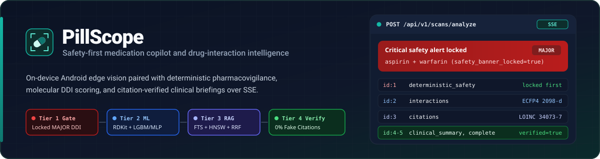
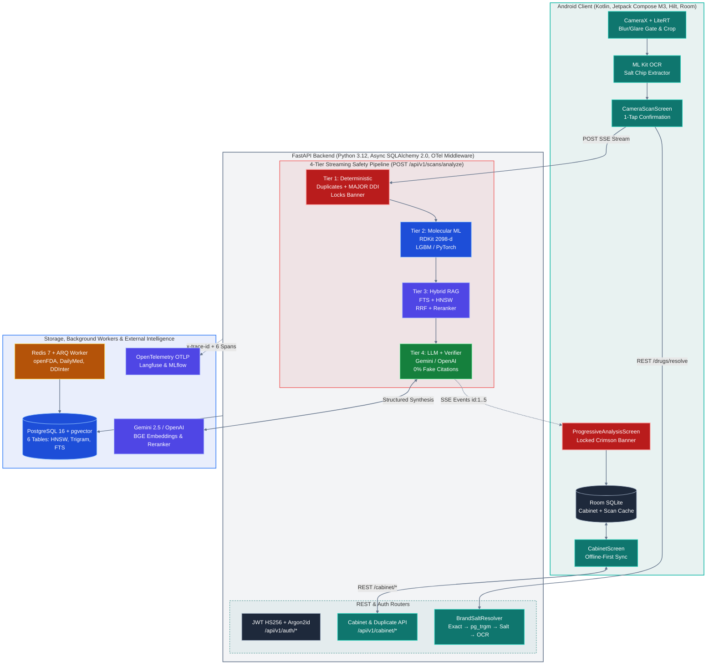
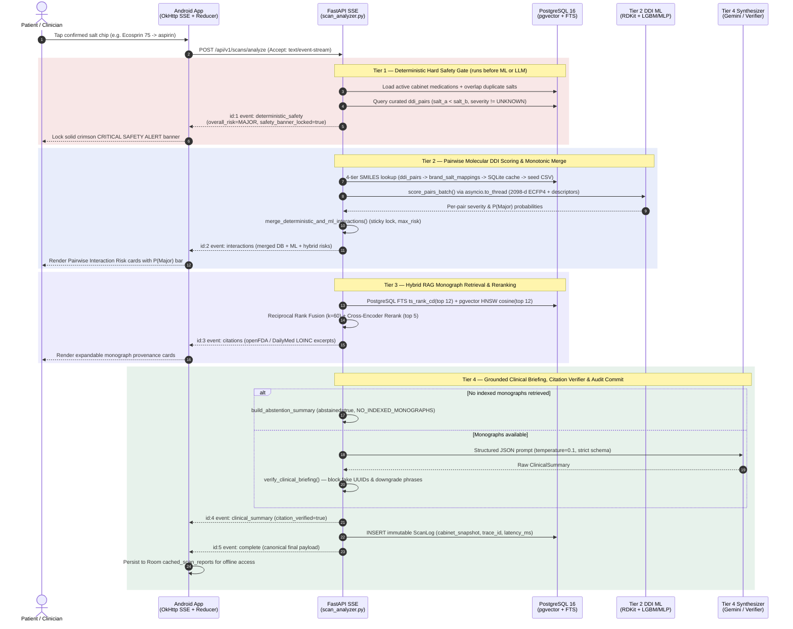
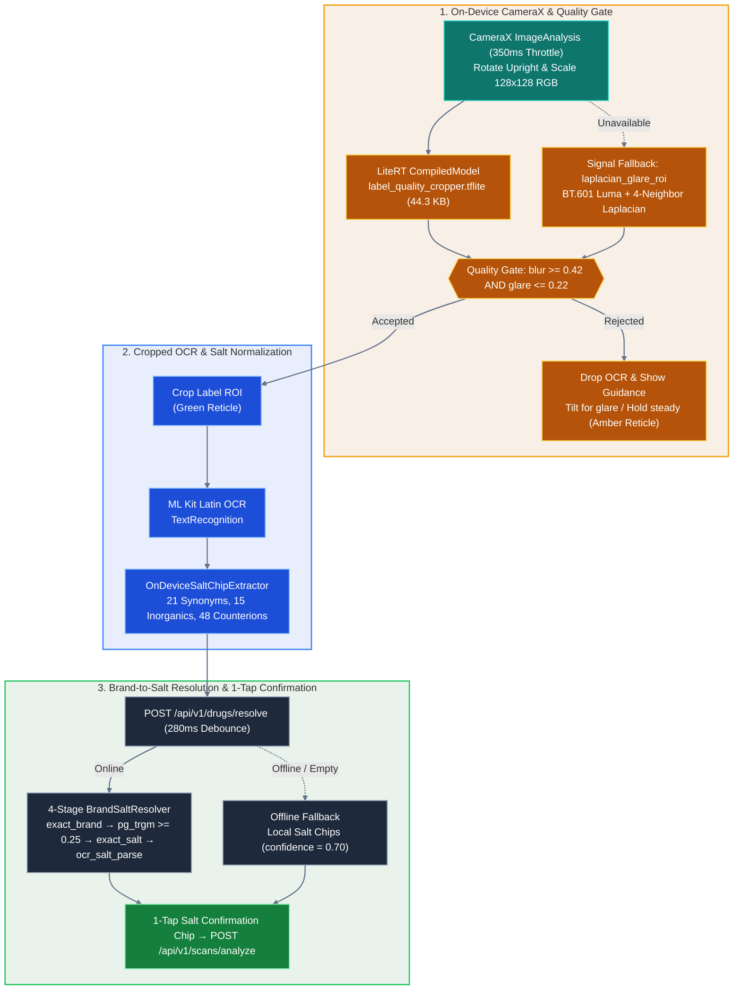
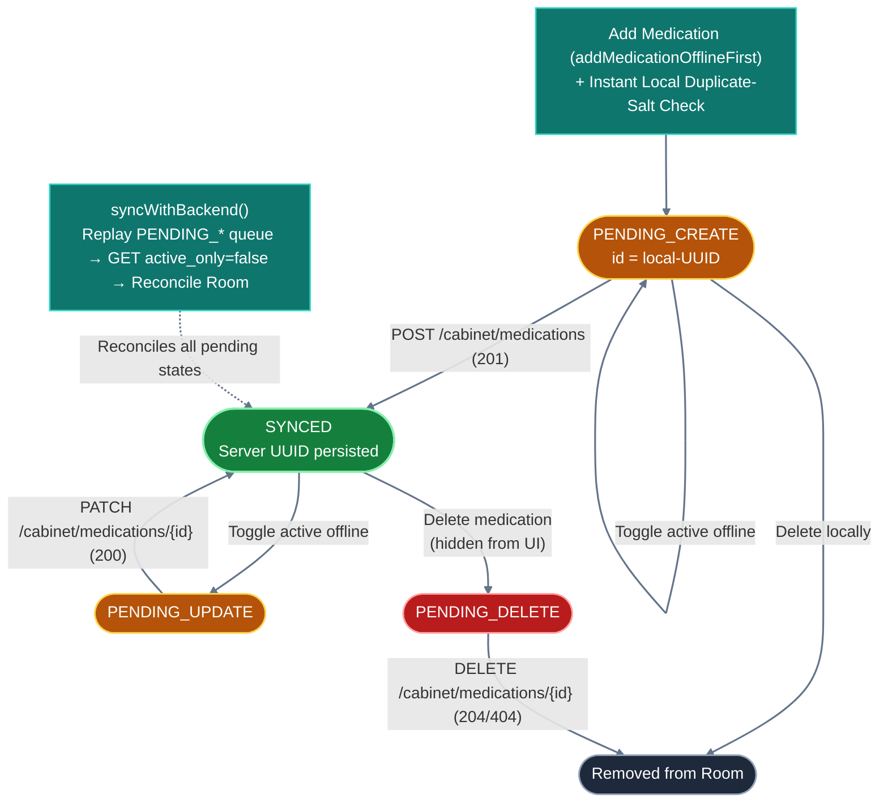
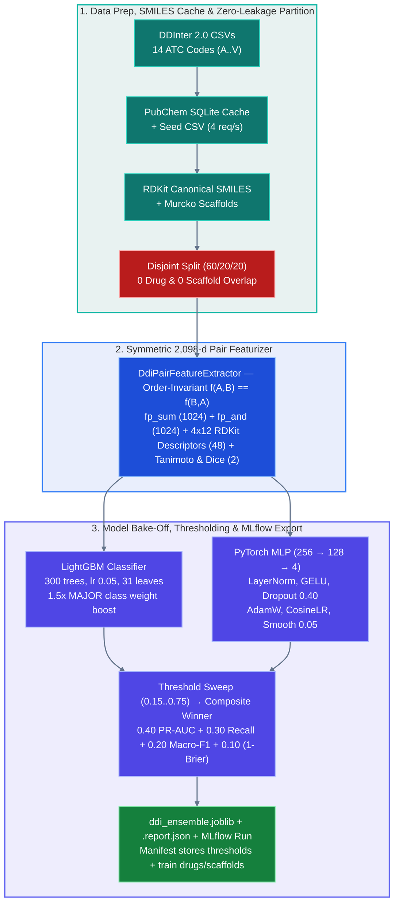
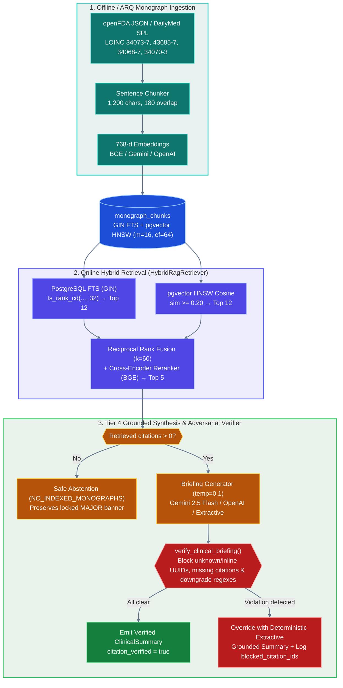
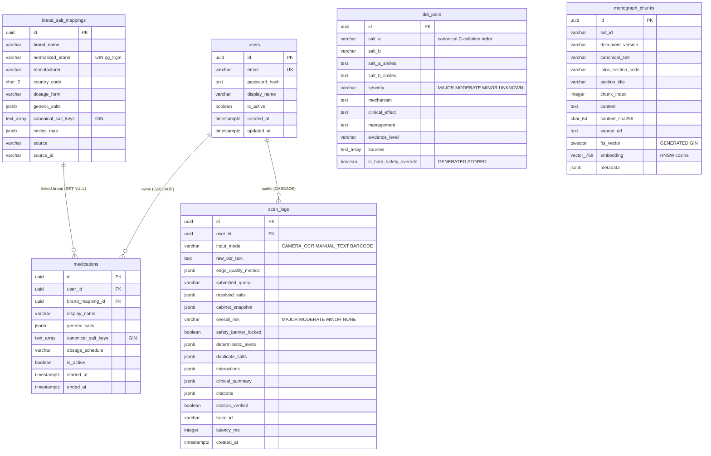
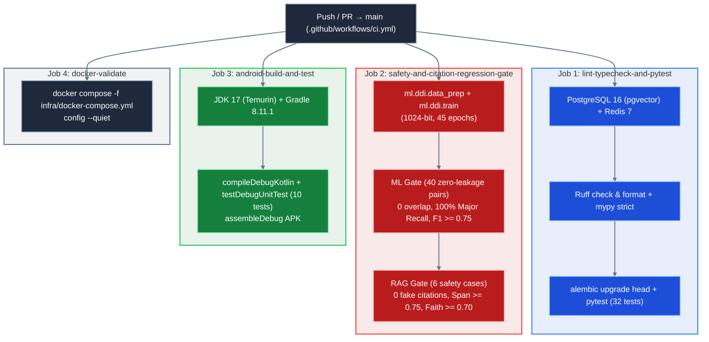

<div align="center">



<br/>

[](pyproject.toml)
[](android/app/build.gradle.kts)
[](backend/app/db/models.py)
[](android/app/src/main/java/com/pillscope/app/ml/LiteRtLabelPreprocessor.kt)
[](.github/workflows/ci.yml)

**On-device Android strip scanning, deterministic pharmacovigilance, pairwise molecular DDI machine learning, and citation-verified openFDA / DailyMed clinical briefings over real-time Server-Sent Events.**

[Architecture](#system-architecture) | [4-Tier Safety Pipeline](#four-tier-safety-pipeline-and-sse-contract) | [Android App](#android-client-and-edge-vision) | [Molecular DDI ML](#pairwise-molecular-ddi-ml-pipeline) | [Hybrid RAG](#hybrid-rag-and-citation-verifier) | [Database Schema](#postgresql-and-pgvector-schema) | [API Reference](#rest-and-sse-api-reference) | [Eval & CI](#evaluation-gates-observability-and-cicd) | [Quickstart](#local-quickstart-and-workflows)

</div>

---

> [!CAUTION]
> **Core Safety Invariant — Deterministic First, Monotonic Always.**
> Duplicate active-salt detection and curated `MAJOR` drug-drug interaction (DDI) checks execute deterministically in Python and PostgreSQL **before** and **independently of** ML inference or LLM synthesis. When either check triggers, `safety_banner_locked = true` and `overall_risk = "MAJOR"` are locked in code and emitted in the very first SSE frame (`id: 1`). Downstream ML models can escalate an unmapped pair's risk, but neither ML nor an LLM can ever downgrade a deterministic `MAJOR` alert, unlock the crimson banner, or emit an unverified monograph citation.

---

## What PillScope solves

Branded medicines sold across India and international markets frequently disguise identical active pharmaceutical ingredients under different trade names (for example, *Augmentin 625 Duo*, *Clavam 625*, and *Mox 500* all contain `amoxicillin`; *Dolo 650*, *Calpol 500*, and *Combiflam* all contain `acetaminophen`). Patients managing multi-drug cabinets face two acute risks: accidental duplicate active-ingredient dosing and severe drug-drug interactions (such as *Ecosprin 75* + *Warf 5* causing gastrointestinal hemorrhage).

PillScope addresses this end-to-end across five integrated subsystems:

| Subsystem | Primary role | Core technology | Entry point |
| --- | --- | --- | --- |
| **Android Edge Client** | Live camera strip scanning, glare/blur filtering, OCR salt extraction, 1-tap confirmation, progressive SSE safety UI, offline medication cabinet | Kotlin 2.0.21, Jetpack Compose M3, CameraX 1.4.1, LiteRT 2.0.3, ML Kit OCR 16.0.1, Room 2.6.1, Hilt 2.52, OkHttp SSE | [`android/`](android/) |
| **Backend API & Safety Engine** | JWT/Argon2id auth, Indian/global brand-to-salt normalization, 4-tier streaming safety analysis, hybrid retrieval, citation verification, audit logging | Python 3.12, FastAPI, `sse-starlette`, async SQLAlchemy 2.0, `asyncpg`, Alembic, Pydantic v2, `structlog` | [`backend/app/`](backend/app/) |
| **Async Data Ingestion** | Background ingestion of DDInter 2.0 DDI catalogs, Indian A–Z brand CSVs, and openFDA / DailyMed SPL clinical monographs | Redis 7, ARQ (`WorkerSettings`), `httpx`, PostgreSQL idempotent `ON CONFLICT` upserts | [`backend/app/workers/`](backend/app/workers/), [`backend/scripts/`](backend/scripts/) |
| **Molecular DDI & Edge Vision ML** | Zero-leakage Murcko-scaffold pairwise DDI severity modeling + lightweight CNN label quality & cropper exported to `.tflite` | RDKit Morgan ECFP4 + descriptors, LightGBM, PyTorch MLP, MLflow, TensorFlow/LiteRT | [`ml/ddi/`](ml/ddi/), [`ml/edge_vision/`](ml/edge_vision/) |
| **Evaluation & Observability** | Automated CI regression gates enforcing 100% Major DDI recall, zero data leakage, 0% fabricated citations, plus distributed tracing | Custom ML & RAG gates, DeepEval / RAGAS hooks, OpenTelemetry SDK, Langfuse OTLP bridge | [`eval/`](eval/) |

---

## System architecture

PillScope separates hard clinical safety rules, probabilistic molecular scoring, document retrieval, and generative summarization into isolated tiers wired over a single persistent HTTP SSE stream.



---

## Four-tier safety pipeline and SSE contract

Every scan posted to `POST /api/v1/scans/analyze` streams five sequential Server-Sent Events (`Content-Type: text/event-stream`) with monotonic `id` headers (`1` through `5`) and strict Pydantic v2 JSON payloads. Both the backend orchestrator ([`backend/app/services/scan_analyzer.py`](backend/app/services/scan_analyzer.py)) and the Android reducer ([`ScanAnalysisReducer`](android/app/src/main/java/com/pillscope/app/data/repository/ScanAnalysisState.kt)) enforce the exact same monotonic lock rules.



### SSE event sequence and invariants

| Seq `id` | Event name | Producer tier | Key fields | Safety invariant enforced |
| --- | --- | --- | --- | --- |
| `1` | `deterministic_safety` | Tier 1 (`deterministic_safety.py`) | `scan_id`, `resolved_salts`, `overall_risk`, `safety_banner_locked`, `duplicate_salts`, `deterministic_alerts` | Emitted **first**, before any ML or LLM call. Locks banner on any duplicate active salt or curated `MAJOR` DDI. |
| `2` | `interactions` | Tier 2 (`ddi_ml_inference.py`) | `scan_id`, `overall_risk`, `safety_banner_locked`, `interactions[]`, `ml_scored_pair_count` | `overall_risk` is monotonically non-decreasing (`max_risk`); deterministic rules retain `confidence = 1.0`. |
| `3` | `citations` | Tier 3 (`hybrid_rag.py`) | `scan_id`, `citations[]` (`chunk_id`, `set_id`, `loinc_section_code`, `lexical_score`, `dense_score`, `rrf_score`, `rerank_score`) | Scoped strictly to `involved_salts` from official openFDA / DailyMed SPL sections. |
| `4` | `clinical_summary` | Tier 4 (`clinical_briefing.py`) | `scan_id`, `overall_risk`, `safety_banner_locked`, `citation_verified`, `blocked_citation_ids`, `clinical_summary`, `citations` | Post-generation verifier blocks fabricated UUIDs (array + inline text), missing citations, and downgrade phrasing. |
| `5` | `complete` | Persistence (`scan_analyzer.py`) | Canonical merged state + `latency_ms` | Persisted to PostgreSQL `scan_logs` with OTel `trace_id` before closing stream; cached in Android Room DB. |

<details>
<summary>Inspect example request and SSE event JSON payloads</summary>

**Request (`POST /api/v1/scans/analyze`):**
```json
{
  "input_mode": "CAMERA_OCR",
  "submitted_query": "Ecosprin 75 Tablet",
  "confirmed_salts": ["aspirin"],
  "raw_ocr_text": "ECOSPRIN 75 Aspirin 75mg Gastro-Resistant Tablets IP",
  "edge_quality_metrics": {
    "blur_score": 0.91,
    "glare_ratio": 0.03,
    "crop_confidence": 0.96
  }
}
```

**Event 1 (`deterministic_safety`):**
```json
{
  "scan_id": "9f81c2b4-41d6-4d7c-99b8-c3d9b4f41201",
  "submitted_query": "Ecosprin 75 Tablet",
  "resolved_salts": ["aspirin"],
  "overall_risk": "MAJOR",
  "safety_banner_locked": true,
  "duplicate_salts": [],
  "deterministic_alerts": [
    {
      "rule_id": "ddi_pairs:4d8e2c90-...",
      "salt_a": "aspirin",
      "salt_b": "warfarin",
      "severity": "MAJOR",
      "mechanism": "Additive antiplatelet and vitamin K antagonist anticoagulation.",
      "clinical_effect": "High risk of severe gastrointestinal bleeding.",
      "management": "Avoid concurrent administration unless supervised with frequent INR monitoring.",
      "sources": ["ddinter_2"]
    }
  ]
}
```

**Event 4 (`clinical_summary`):**
```json
{
  "scan_id": "9f81c2b4-41d6-4d7c-99b8-c3d9b4f41201",
  "overall_risk": "MAJOR",
  "safety_banner_locked": true,
  "citation_verified": true,
  "blocked_citation_ids": [],
  "clinical_summary": {
    "headline": "MAJOR bleeding risk when combining Aspirin with Warfarin.",
    "patient_explanation": "Concomitant use of aspirin with warfarin sodium significantly increases the risk of serious gastrointestinal bleeding and requires frequent INR monitoring.",
    "actionable_next_steps": [
      "Pause before taking this medication alongside your active cabinet.",
      "Contact your prescribing clinician or pharmacist immediately to review alternatives."
    ],
    "cited_chunk_ids": ["11111111-1111-4111-8111-111111111111"],
    "abstained": false,
    "abstention_reason": null,
    "disclaimer": "Informational safety check only; consult a licensed clinician or pharmacist before starting, stopping, or changing any medication."
  },
  "citations": [
    {
      "chunk_id": "11111111-1111-4111-8111-111111111111",
      "set_id": "d91934a0-902e-c26c-23ca-d5accc4151b6",
      "canonical_salt": "warfarin",
      "section_key": "drug_interactions",
      "section_title": "DRUG INTERACTIONS",
      "loinc_section_code": "34073-7",
      "excerpt": "Concomitant use of aspirin or NSAIDs with warfarin sodium significantly increases the risk of serious and potentially fatal gastrointestinal bleeding.",
      "source_url": "https://dailymed.nlm.nih.gov/dailymed/drugInfo.cfm?setid=d91934a0-902e-c26c-23ca-d5accc4151b6",
      "rerank_score": 0.96
    }
  ]
}
```

</details>

---

## Android client and edge vision

The native Android application (`com.pillscope.app`, `minSdk 26`, `compileSdk 35`, `targetSdk 35`, Java 17) is built with Jetpack Compose Material 3, Hilt dependency injection, Room offline persistence, CameraX, Google LiteRT (`CompiledModel`), and ML Kit Text Recognition.

### On-device camera vision and brand-to-salt resolution

Blister foil strips frequently produce specular glare and motion blur that corrupt OCR. `MedicineLabelAnalyzer` gates every frame on-device before ML Kit runs, cutting false brand reads and battery drain.



#### Bundled LiteRT vision model (`label_quality_cropper.tflite`)
- **Trainer & exporter:** [`ml/edge_vision/export_label_quality_model.py`](ml/edge_vision/export_label_quality_model.py) trains a synthetic dataset (`1,200` train / `300` val samples covering crisp, box-blurred, and Gaussian-glare medicine labels) using a compact depthwise-separable CNN (`Conv2D(16)` → `3× DepthwiseConv2D + pointwise Conv2D(24/32/48)` → dual `GlobalAveragePooling2D` + `GlobalMaxPooling2D` → `Dense(48, relu)` → `Dense(7, sigmoid)`).
- **Binary contract:** Stored uncompressed (`noCompress += ["tflite", "litertlm"]`) at [`android/app/src/main/assets/label_quality_cropper.tflite`](android/app/src/main/assets/label_quality_cropper.tflite) (**44,308 bytes**).
  - Input tensor: `[1, 128, 128, 3]` `FLOAT32` normalized RGB `[0, 1]`.
  - Output tensor: `[1, 7]` `FLOAT32` → `[blur_score, glare_ratio, left, top, right, bottom, crop_confidence]`.
- **Automatic fallback:** If the LiteRT engine is unavailable, `LiteRtLabelPreprocessor.evaluateSignalQualityAndCrop` computes BT.601 luminance (`0.299R + 0.587G + 0.114B`), counts blown-white glare pixels (`R,G,B >= 248`), computes 4-neighbor Laplacian variance `V / (V + 320.0)`, and derives a padded bounding box from strong edges (`|lap| >= 28`).

### Compose screens and clinical design tokens

`PillScopeApp` hoists `ScanViewModel`, `AnalysisViewModel`, and `CabinetViewModel` at the root `NavHost` so live stream state and camera results persist seamlessly across the three bottom navigation tabs:

| Tab / Route | Screen & ViewModel | Capabilities |
| --- | --- | --- |
| **Scan** (`"scan"`) | [`CameraScanScreen.kt`](android/app/src/main/java/com/pillscope/app/ui/scan/CameraScanScreen.kt), [`ScanViewModel.kt`](android/app/src/main/java/com/pillscope/app/ui/scan/ScanViewModel.kt) | Runtime `CAMERA` permission flow, live `PreviewView`, dynamic green/amber crop reticle overlay, Freeze/Resume toggle, live sharpness/glare telemetry bar, debounced manual brand/salt search (`280ms`), 1-tap `BrandConfirmationChipCard`s, on-device OCR `AssistChip`s, direct fallback analyze button. |
| **Safety** (`"analysis"`) | [`ProgressiveAnalysisScreen.kt`](android/app/src/main/java/com/pillscope/app/ui/analysis/ProgressiveAnalysisScreen.kt), [`AnalysisViewModel.kt`](android/app/src/main/java/com/pillscope/app/ui/analysis/AnalysisViewModel.kt) | Risk header badge (`MAJOR` / `MODERATE` / `MINOR` / `NONE`), non-dismissible solid crimson `LockedCriticalSafetyBanner`, stage-aware `LinearProgressIndicator`, pairwise `InteractionRiskCard`s with ML `P(Major)` progress meters, `ClinicalSummaryCard` with verified/abstained status, expandable LOINC monograph cards. `AnalysisViewModel` also exposes `cachedHistory` (30 most recent Room reports) and `openCachedReport(scanId)` for offline viewing. |
| **Cabinet** (`"cabinet"`) | [`CabinetScreen.kt`](android/app/src/main/java/com/pillscope/app/ui/cabinet/CabinetScreen.kt), [`CabinetViewModel.kt`](android/app/src/main/java/com/pillscope/app/ui/cabinet/CabinetViewModel.kt) | Offline-first Room medication list with active toggles, delete action, manual Sync trigger, `AddMedicationDialog`, per-card sync status (`Synced` / `Pending sync`), and instant crimson `DUPLICATE ACTIVE SALT DETECTED` alert banners even without network connectivity. |

<details>
<summary>Clinical Material 3 palette & Android build configuration</summary>

**`PillScopeColors` ([`Theme.kt`](android/app/src/main/java/com/pillscope/app/ui/theme/Theme.kt)):**
| Semantic token | Foreground / Fill | Container / Surface | Usage |
| --- | --- | --- | --- |
| `ClinicalTeal` | `#0F766E` | `#CCFBF1` (`onPrimaryContainer #115E59`) | Primary actions, FAB, confirmed generic salts, active reticles |
| `CriticalCrimson` | `#B91C1C` (dark `#7F1D1D`) | `#FEF2F2` | Locked `MAJOR` alert banner, duplicate active salt alerts |
| `ModerateAmber` | `#B45309` | `#FFFBEB` | `MODERATE` interactions, glare/blur warnings, pending sync badges |
| `MinorBlue` | `#1D4ED8` | `#EFF6FF` | `MINOR` interactions, monograph source URLs |
| `SafeEmerald` | `#15803D` | `#F0FDF4` | `NONE` risk, `Synced` indicator, citation-verified badge |
| `InkPrimary` / `SlateSurface` | `#0F172A` / `#475569` | `#F8FAFC` / `#FFFFFF` (border `#E2E8F0`) | Typography hierarchy and card surfaces |

**Key Gradle & DI Settings ([`android/app/build.gradle.kts`](android/app/build.gradle.kts), [`AppModules.kt`](android/app/src/main/java/com/pillscope/app/di/AppModules.kt)):**
- Default emulator API URL: `BuildConfig.API_BASE_URL = "http://10.0.2.2:8000/"`
- Standard REST OkHttp timeouts: `connect 15s`, `read 60s`, `write 15s`; SSE client overrides `readTimeout(0)` for open streams.
- Auth tokens: `SharedPrefsAuthTokenStore` (`pillscope_auth_prefs`) injected into `BearerAuthInterceptor`.
- Room DB: `"pillscope_offline.db"` (version `1`), tables `cabinet_medications` and `cached_scan_reports`.
- Serialization: `kotlinx.serialization.json.Json` with `ignoreUnknownKeys = true`, `coerceInputValues = true`, `encodeDefaults = true`, `explicitNulls = false` (prevents `PATCH` requests from overwriting omitted fields with `null`).

</details>

### Offline-first cabinet sync state machine

`CabinetRepository` writes every mutation to Room immediately so users can manage medications and run local duplicate-salt checks offline, reconciling pending operations against PostgreSQL when connectivity returns.



---

## Pairwise molecular DDI ML pipeline

To flag potentially hazardous combinations that are not yet present in curated interaction tables, [`ml/ddi/`](ml/ddi/) trains a pairwise molecular severity classifier over four ordered classes (`NONE`, `MINOR`, `MODERATE`, `MAJOR`) with strict leakage prevention and safety-biased probability thresholding.



### Feature vector specification (`2,098` dimensions by default)

[`DdiPairFeatureExtractor`](ml/ddi/features.py) computes an order-invariant pair representation (`f(A, B) == f(B, A)` verified in unit tests) with an 8,192-entry LRU molecule cache:

| Block | Formula | Dimensions (`fp_bits = 1024`) | Purpose |
| --- | --- | --- | --- |
| **Morgan ECFP4 Sum** | `fp(A) + fp(B)` (`radius=2`, chirality enabled) | `1,024` | Captures additive presence of pharmacophore substructures across both drugs |
| **Morgan ECFP4 Intersection** | `fp(A) * fp(B)` | `1,024` | Captures shared substructures (e.g., overlapping CYP substrates or NSAID scaffolds) |
| **Physicochemical Descriptors** | `mean`, `abs_diff`, `min`, `max` over 12 RDKit descriptors (`MolWt`, `MolLogP`, `TPSA`, `NumHDonors`, `NumHAcceptors`, `NumRotatableBonds`, `NumAromaticRings`, `NumAliphaticRings`, `FractionCSP3`, `HeavyAtomCount`, `RingCount`, `QED`) | `48` (`4 × 12`) | Captures lipophilicity, polarity, size, and drug-likeness interactions |
| **Molecular Similarity** | `TanimotoSimilarity`, `DiceSimilarity` | `2` | Quantifies structural similarity between paired compounds |

### Runtime SMILES resolution and safety thresholds

1. **4-tier runtime SMILES lookup (`scan_analyzer.py`):** Queries `ddi_pairs` (`salt_a_smiles`/`salt_b_smiles`) → `brand_salt_mappings.smiles_map` → local SQLite `data/cache/pubchem_smiles_cache.sqlite3` → bundled [`ml/ddi/fixtures/drug_smiles_seed.csv`](ml/ddi/fixtures/drug_smiles_seed.csv) (40 canonical drugs).
2. **Safety thresholding (`apply_safety_thresholds`):** Starts from `argmax(probs)`, promotes to `MODERATE` if `P(MODERATE) >= moderate_threshold` (default `0.35`), and promotes to `MAJOR` if `P(MAJOR) >= major_threshold` (tuned per artifact, optionally overridable via `DDI_ML_MAJOR_THRESHOLD`).
3. **Monotonic merge (`merge_deterministic_and_ml_interactions`):** Curated DB rows always retain `confidence = 1.0` and their curated mechanism/management (`source = "hybrid"` when also scored by ML, `"deterministic_db"` otherwise). Unmapped pairs predicted above `NONE` are emitted with `source = "ml_model"` and their `ml_major_probability`.

---

## Hybrid RAG and citation verifier

Clinical explanations are grounded exclusively in official regulatory monographs ingested from openFDA and DailyMed SPL XML, retrieved through hybrid lexical + dense vector search, reranked by a cross-encoder, and audited by a deterministic post-generation verifier before delivery.



### Indexed clinical SPL sections and provider matrix

| Clinical section key | LOINC code(s) mapped | openFDA JSON fields parsed | Purpose |
| --- | --- | --- | --- |
| `drug_interactions` | `34073-7` | `drug_interactions` | Direct clinical interaction evidence & mechanism |
| `warnings` | `43685-7` (normalizes `34071-1`, `34066-1` Boxed Warning) | `boxed_warning`, `warnings_and_cautions`, `warnings_and_precautions`, `warnings` | Black-box warnings, bleeding/hypersensitivity precautions |
| `dosage_and_administration` | `34068-7` | `dosage_and_administration` | Standard dosing intervals and monitoring thresholds |
| `contraindications` | `34070-3` | `contraindications` | Absolute clinical contraindications |

- **Embedding providers ([`embeddings.py`](backend/app/services/embeddings.py)):** `SentenceTransformerEmbeddingProvider` (`BAAI/bge-base-en-v1.5` with BGE query instruction prefix, default), `GeminiEmbeddingProvider` (`text-embedding-004` with `RETRIEVAL_DOCUMENT` / `RETRIEVAL_QUERY` task types), `OpenAIEmbeddingProvider` (`text-embedding-3-small`), and offline deterministic `HashingEmbeddingProvider` (word unigrams + bigrams + char 3-grams via BLAKE2b).
- **Rerankers ([`reranker.py`](backend/app/services/reranker.py)):** `SentenceTransformerCrossEncoderReranker` (`BAAI/bge-reranker-base` with clamped sigmoid scoring) and deterministic `LexicalCrossReranker` (for offline testing).
- **Briefing synthesizers ([`clinical_briefing.py`](backend/app/services/clinical_briefing.py)):** `GeminiBriefingGenerator` (`gemini-2.5-flash` with enforced JSON `responseSchema`), `OpenAiBriefingGenerator` (`response_format: json_object`), and automatic fallback to `DeterministicGroundedBriefingGenerator` when no API key is configured or an upstream LLM request fails.
- **Anti-downgrade regex guard:** While `safety_banner_locked = true`, `verify_clinical_briefing` rejects any LLM output matching phrases like `"no major/serious/significant interaction"`, `"safe to take/use/combine together"`, `"no interactions found/detected"`, `"no safety concerns"`, or `"low risk"`, replacing it with `build_extractive_grounded_summary`.
- **ARQ background workers ([`backend/app/workers/`](backend/app/workers/)):** `WorkerSettings` connects to Redis (`max_jobs = 8`, `job_timeout = 300s`) and runs `ingest_drug_monographs_job` (live openFDA/DailyMed fetch) and `ingest_monographs_from_file_job` (local openFDA JSON file ingestion).

---

## PostgreSQL and pgvector schema

Managed by two Alembic revisions ([`0001_initial_schema.py`](backend/app/db/migrations/versions/0001_initial_schema.py) and [`0002_ddi_pairs_c_collation_order.py`](backend/app/db/migrations/versions/0002_ddi_pairs_c_collation_order.py)) with required extensions `pgcrypto`, `vector`, and `pg_trgm` enabled via [`01_extensions.sql`](infra/postgres/init/01_extensions.sql).



### Critical constraints and specialized indexes

| Table | Index / Constraint | Purpose |
| --- | --- | --- |
| `brand_salt_mappings` | `UNIQUE (normalized_brand, country_code, COALESCE(dosage_form, ''))` | Idempotent brand catalog upserts across dosage forms |
| `brand_salt_mappings` | `GIN (normalized_brand gin_trgm_ops)` + `GIN (canonical_salt_keys)` | Fuzzy OCR brand matching (`pg_trgm`) and reverse lookup by salt |
| `medications` | `BTREE (user_id, is_active)` + `GIN (canonical_salt_keys)` | Fast active-cabinet overlap (`canonical_salt_keys && candidate_keys`) |
| `ddi_pairs` | `CHECK ((salt_a COLLATE "C") < (salt_b COLLATE "C"))` + `UNIQUE (salt_a, salt_b)` | Matches Python lexicographic ordering across locales; eliminates mirror rows |
| `ddi_pairs` | Partial `BTREE (salt_a, salt_b) WHERE severity = 'MAJOR'` + `is_hard_safety_override` | Sub-millisecond Tier 1 hard safety lookups |
| `monograph_chunks` | `HNSW (embedding vector_cosine_ops) WITH (m = 16, ef_construction = 64)` + `GIN (fts_vector)` | Dual semantic + BM25/FTS retrieval over 768-dim SPL chunks |
| `scan_logs` | `BTREE (user_id, created_at DESC)` + `BTREE (overall_risk, created_at DESC)` | Fast user history pagination and clinical risk auditing |

### Drug and salt normalization rules ([`drug_normalizer.py`](backend/app/services/drug_normalizer.py))

Shared semantically between Python (`drug_normalizer.py`) and Kotlin (`OnDeviceSaltChipExtractor`):
- **21 Indian/British-to-canonical synonyms:** e.g., `amoxycillin` → `amoxicillin`, `paracetamol` → `acetaminophen`, `potassium clavulanate` → `clavulanic acid`, `salbutamol` → `albuterol`, `frusemide` → `furosemide`, `lignocaine` → `lidocaine`, `acetylsalicylic acid` → `aspirin`, `cholecalciferol` → `vitamin d3`, `glibenclamide` → `glyburide`, `adrenaline` → `epinephrine`.
- **24 preserved inorganic compounds** (counterion not stripped): e.g., `calcium carbonate`, `potassium chloride`, `ferrous sulfate`, `lithium carbonate`, `sodium bicarbonate`, `magnesium hydroxide`, `zinc sulfate`.
- **55 stripped counterion, hydrate & pharmacopoeia suffixes:** e.g., `hydrochloride`, `hcl`, `sodium`, `potassium`, `besylate`, `mesylate`, `trihydrate`, `ip`, `bp`, `usp`, plus release modifiers (`sr`, `xr`, `er`, `pr`, `dr`, `cr`, `ec`, `mr`, `dt`).
- **Dosage-form extraction & strength conversion:** Parses `mg`, `mcg`/`ug`/`µg` (→ `mg / 1000`), `g`/`gm` (→ `mg * 1000`), `ml`, `iu`, `%`, and 26 dosage-form keywords (`tablet`, `capsule`, `syrup`, `suspension`, `injection`, `inhaler`/`rotacap`/`respule`, `drops`, `ointment`, `cream`, `gel`, `spray`, `powder`/`sachet`).

---

## REST and SSE API reference

All routes are mounted in [`backend/app/main.py`](backend/app/main.py). Every HTTP response carries an `X-Trace-Id` header (32-char OpenTelemetry trace ID) attached by [`OpenTelemetryMiddleware`](backend/app/core/telemetry.py).

| Group | Method | Path | Auth | Behavior |
| --- | --- | --- | --- | --- |
| **Health** | `GET` | `/healthz` | Public | Process liveness probe (`{"status": "ok"}`) |
| **Health** | `GET` | `/readyz` | Public | Verifies PostgreSQL connectivity, extensions (`vector`, `pg_trgm`, `pgcrypto`), and Redis `PING` (`200` / `503`) |
| **Auth** | `POST` | `/api/v1/auth/register` | Public | Creates user (`Argon2id` hash, `password >= 8` chars); returns `201` with access (`30m`) + refresh (`14d`) HS256 JWTs |
| **Auth** | `POST` | `/api/v1/auth/login` | Public | Verifies credentials and active account; returns user profile + token pair |
| **Auth** | `POST` | `/api/v1/auth/refresh` | Refresh JWT | Validates `token_type = "refresh"` and rotates access + refresh tokens |
| **Auth** | `GET` | `/api/v1/auth/me` | Bearer JWT | Returns current authenticated `UserResponse` |
| **Drugs** | `POST` | `/api/v1/drugs/resolve` | Bearer JWT | 4-stage resolution (`exact_brand` → `trigram_brand` → `exact_salt` → `ocr_salt_parse`) returning ranked candidates + `extracted_salts` |
| **Drugs** | `GET` | `/api/v1/drugs/search` | Bearer JWT | Autocomplete search (`?q=&country=IN&limit=10`, max `25`) backed by `BrandSaltResolver` |
| **Cabinet** | `GET` | `/api/v1/cabinet/medications` | Bearer JWT | Lists user medications (`?active_only=true` default, ordered by `created_at DESC`) |
| **Cabinet** | `POST` | `/api/v1/cabinet/medications` | Bearer JWT | Adds medication by `brand_mapping_id` or explicit `display_name` + `generic_salts`; runs immediate duplicate-salt safety check |
| **Cabinet** | `PATCH` | `/api/v1/cabinet/medications/{id}` | Bearer JWT | Partial update of `display_name`, `dosage_schedule`, `is_active`, `started_at`, `ended_at` |
| **Cabinet** | `DELETE` | `/api/v1/cabinet/medications/{id}` | Bearer JWT | Removes medication from user cabinet (`204 No Content`) |
| **Cabinet** | `POST` | `/api/v1/cabinet/check-duplicates` | Bearer JWT | Pre-flight duplicate active-salt check from `confirmed_salts`, `brand_name`, or `raw_ocr_text` |
| **Scans** | `POST` | `/api/v1/scans/analyze` | Bearer JWT | Executes the 4-tier safety pipeline and streams 5 SSE events (`text/event-stream`), persisting an immutable `ScanLog` |
| **Scans** | `GET` | `/api/v1/scans` | Bearer JWT | Paginated scan audit history (`?limit=20&offset=0`, max `100`) |
| **Scans** | `GET` | `/api/v1/scans/{scan_id}` | Bearer JWT | Retrieves full persisted scan briefing, alerts, and verified citations |
| **Internal** | `POST` | `/api/v1/internal/jobs/ingest` | `X-Admin-API-Key` | Constant-time key check; enqueues `ingest_drug_monographs_job` in Redis/ARQ (`202 Accepted`, up to 50 drugs per batch) |

---

## Evaluation gates, observability and CI/CD

GitHub Actions ([`.github/workflows/ci.yml`](.github/workflows/ci.yml)) runs four parallel verification jobs on every push and pull request targeting `main`. Any regression in Major DDI recall, zero-leakage guarantees, or citation fabrication blocks the build with exit code `1`.



### Evaluation datasets and hard gate criteria

- **ML Holdout Benchmark ([`eval/datasets/major_ddi_holdout.json`](eval/datasets/major_ddi_holdout.json), [`ml_eval_gate.py`](eval/benchmarks/ml_eval_gate.py)):**
  - `40` real DDInter 2.0 pairs across `30` unique drugs (`16 MAJOR`, `10 MODERATE`, `6 MINOR`, `8 NONE`) with **0 drugs and 0 Murcko scaffolds** shared with either the real DDInter training split or the offline CI fixture (`ml/ddi/fixtures/ddinter_real_sample.csv`).
  - Verifies four conditions: `zero_leakage_verified == True`, `combined_safety_metrics.major_recall >= 1.0`, `combined_safety_metrics.macro_f1 >= 0.75`, and `ml_only_metrics.major_recall >= 0.70`.
- **RAG Safety & Citation Regression Suite ([`eval/datasets/rag_safety_cases.json`](eval/datasets/rag_safety_cases.json), [`rag_eval_gate.py`](eval/rag_eval/rag_eval_gate.py), [`citation_verifier.py`](eval/rag_eval/citation_verifier.py)):**
  - `6` cases covering `grounded_normal` (2), `adversarial_fabrication` (1 — fabricated UUID injection), `adversarial_downgrade` (1 — LLM claiming `"Safe to take together"` on a locked duplicate-salt alert), and `missing_monograph` (2 — unindexed salts both unlocked and with a locked `MAJOR` alert).
  - Supports deterministic span-overlap scoring (`>= 45%` salient token overlap per sentence) plus optional `deepeval` (`FaithfulnessMetric`) and `ragas` (`Faithfulness`) LLM judge backends via `--judge`.
  - Enforces `0` leaked fabricated citations, `100%` fabrication block rate, `100%` major-downgrade block rate, `100%` missing-monograph abstention rate, `mean_span_support >= 0.75`, and `mean_faithfulness >= 0.70`.

### OpenTelemetry & Langfuse trace hierarchy ([`eval/tracing/otel.py`](eval/tracing/otel.py))

Every scan records six nested spans exported via standard OTLP HTTP (`OTEL_EXPORTER_OTLP_ENDPOINT`) and/or Langfuse's OTLP endpoint (`/api/public/otel/v1/traces` with Basic auth):

1. `HTTP POST /api/v1/scans/analyze` (`http.request.method`, `url.path`, `http.response.status_code`, `pillscope.http.duration_ms`)
2. `pillscope.scan.analyze` (`pillscope.scan_id`, `pillscope.input_mode`, `pillscope.overall_risk`, `pillscope.safety_banner_locked`, `pillscope.citation_verified`, `pillscope.latency_ms`)
3. `pillscope.scan.deterministic_safety` (`pillscope.resolved_salt_count`, `pillscope.duplicate_count`, `pillscope.deterministic_alert_count`, `pillscope.duration_ms`)
4. `pillscope.scan.ml_ddi` (`pillscope.ml.model_name`, `pillscope.ml.scored_pairs`, `pillscope.duration_ms`)
5. `pillscope.rag.retrieve` (`pillscope.rag.salt_count`, `pillscope.rag.lexical_hits`, `pillscope.rag.dense_hits`, `pillscope.rag.fused_hits`, `pillscope.rag.reranked_hits`, `pillscope.rag.duration_ms`)
6. `pillscope.llm.synthesize` (`gen_ai.system`, `gen_ai.request.model`, `gen_ai.usage.input_tokens`, `gen_ai.usage.output_tokens`, `gen_ai.usage.total_tokens`, `pillscope.llm.abstained`, `pillscope.llm.blocked_citation_count`, `pillscope.llm.latency_ms`)

### Automated test suite inventory (`42` tests)

| Suite | Tests | Verified guarantees |
| --- | --- | --- |
| [`backend/tests/test_scaffold.py`](backend/tests/test_scaffold.py) | 5 | Settings validation, staging/production secret enforcement, app bootstrap |
| [`backend/tests/test_drug_normalizer.py`](backend/tests/test_drug_normalizer.py) | 5 | Indian synonyms, preserved inorganics, counterion stripping, composition & OCR salt extraction |
| [`backend/tests/test_integration_phase1.py`](backend/tests/test_integration_phase1.py) | 6 | `/healthz` & `/readyz`, JWT register/login/refresh lifecycle, idempotent Indian brand & DDInter ingestion, trigram fuzzy search, cabinet duplicate detection |
| [`backend/tests/test_ddi_ml_inference.py`](backend/tests/test_ddi_ml_inference.py) | 3 | Single/batch order invariance, invalid SMILES & missing artifact errors, monotonic deterministic+ML merge |
| [`backend/tests/test_phase3_rag_sse.py`](backend/tests/test_phase3_rag_sse.py) | 6 | openFDA & DailyMed SPL parsing, Hybrid RAG retrieval + RRF, full 5-event SSE stream, adversarial hallucination & downgrade blocking, safe abstention |
| [`ml/ddi/test_ddi_pipeline.py`](ml/ddi/test_ddi_pipeline.py) | 4 | PubChem SQLite cache + 429 retry handling, symmetric RDKit featurizer, zero-leakage scaffold split, LightGBM/PyTorch training & `.joblib` serialization |
| [`eval/test_phase4_eval_and_tracing.py`](eval/test_phase4_eval_and_tracing.py) | 3 | Offline ML safety gate, RAG citation-span & faithfulness gate, 6-span OTel + `x-trace-id` + token metering verification |
| [`android/app/src/test/.../CabinetRepositoryTest.kt`](android/app/src/test/java/com/pillscope/app/CabinetRepositoryTest.kt) | 2 | Offline Room queue + local duplicate detection + backend reconciliation, partial `PATCH` null omission |
| [`android/app/src/test/.../ScanRepositoryAndEdgeVisionTest.kt`](android/app/src/test/java/com/pillscope/app/ScanRepositoryAndEdgeVisionTest.kt) | 4 | SSE-to-Room scan caching, offline OCR fallback resolution, Indian & generic strip salt extraction, Laplacian/glare rejection |
| [`android/app/src/test/.../ScanSseParserAndReducerTest.kt`](android/app/src/test/java/com/pillscope/app/ScanSseParserAndReducerTest.kt) | 4 | 5-event wire parsing, malformed JSON recovery, monotonic banner-lock immunity to downgrades/errors, `OkHttpScanSseClient` MockWebServer streaming |

---

## Monorepo structure

```text
PillScope/
├── ARCHITECTURE.md                       # Architectural specification & schema blueprint
├── README.md                             # Project documentation (this file)
├── pyproject.toml                        # Python 3.12 workspace deps (core, ml, eval, dev), Ruff, pytest, mypy
├── uv.lock                               # Deterministic Python dependency lockfile
├── alembic.ini                           # Alembic migration config pointing to backend/app/db/migrations
├── .env.example                          # Full environment variable template
├── .github/workflows/ci.yml              # 4-job GitHub Actions CI & safety gate pipeline
├── docs/assets/pillscope-banner.svg      # Clinical vector hero banner
├── backend/
│   ├── app/
│   │   ├── main.py                       # FastAPI factory, CORS, OTel middleware, router registration
│   │   ├── core/                         # config.py, security.py (JWT/Argon2), logging.py, telemetry.py
│   │   ├── db/                           # base.py, models.py (6 ORM tables), session.py, migrations/ (0001, 0002)
│   │   ├── schemas/                      # auth.py, cabinet.py, drugs.py, safety.py, scans.py
│   │   ├── api/                          # auth.py, cabinet.py, deps.py, drugs.py, health.py, internal.py, scans.py
│   │   ├── services/                     # brand_resolver, clinical_briefing, ddi_ml_inference, deterministic_safety,
│   │   │                                 # drug_normalizer, embeddings, hybrid_rag, monograph_ingestion, reranker, scan_analyzer
│   │   └── workers/                      # settings.py (ARQ WorkerSettings), tasks.py
│   ├── scripts/                          # ingest_indian_brands.py, ingest_ddinter.py, ingest_monographs.py
│   └── tests/                            # Pytest suites + indian_brands_sample.csv (22 rows) + openfda_sample_labels.json (3 drugs)
├── ml/
│   ├── ddi/                              # data_prep.py, features.py, splits.py, models.py, train.py, artifact.py, schemas.py,
│   │                                     # test_ddi_pipeline.py, fixtures/ (ddinter_real_sample.csv 232 rows, drug_smiles_seed.csv 40 drugs)
│   ├── edge_vision/                      # export_label_quality_model.py (Keras CNN -> LiteRT .tflite)
│   └── artifacts/                        # Local trained models & reports (git-ignored)
├── eval/
│   ├── benchmarks/ml_eval_gate.py        # Offline zero-leakage & 100% Major recall gate
│   ├── rag_eval/                         # citation_verifier.py, rag_eval_gate.py (deterministic / DeepEval / RAGAS)
│   ├── tracing/otel.py                   # OpenTelemetry TracerProvider, OTLP & Langfuse exporters, InMemorySpanCollector
│   ├── datasets/                         # major_ddi_holdout.json (40 pairs), rag_safety_cases.json (6 cases)
│   └── test_phase4_eval_and_tracing.py   # End-to-end eval gate & OTel span assertions
├── android/
│   ├── build.gradle.kts                  # Gradle 8.11.1 + AGP 8.7.3 + Kotlin 2.0.21 + KSP + Hilt 2.52
│   ├── gradle/libs.versions.toml         # Version catalog
│   └── app/src/
│       ├── main/
│       │   ├── assets/label_quality_cropper.tflite   # Bundled 44.3 KB LiteRT quality & ROI cropper
│       │   └── java/com/pillscope/app/
│       │       ├── di/AppModules.kt      # NetworkModule, DatabaseModule, MlModule
│       │       ├── data/                 # Room DB/entities/DAOs, Retrofit API, AuthTokenStore, OkHttp SSE, repositories
│       │       ├── ml/                   # FrameQuality, LiteRtLabelPreprocessor, MlKitOcrEngine, MedicineLabelAnalyzer
│       │       └── ui/                   # PillScopeApp, theme/Theme.kt, scan/, analysis/, cabinet/
│       └── test/java/com/pillscope/app/  # 10 JUnit 4 + Coroutines + MockWebServer tests
└── infra/
    ├── docker-compose.yml                # postgres (pgvector:pg16), redis (7-alpine), api (uvicorn), worker (arq)
    ├── docker/
    │   ├── backend.Dockerfile            # Multi-stage uv + Python 3.12 non-root runtime image
    │   └── android-builder.Dockerfile    # Eclipse Temurin JDK 17 + Android SDK 35 + Gradle 8.11.1
    └── postgres/init/01_extensions.sql   # Enables pgcrypto, vector, pg_trgm
```

---

## Local quickstart and workflows

### Prerequisites

- **Python 3.12** and [`uv`](https://docs.astral.sh/uv/)
- **Docker** & **Docker Compose** (for PostgreSQL 16 + `pgvector` and Redis 7)
- **JDK 17** and Android SDK 35 (or use [`infra/docker/android-builder.Dockerfile`](infra/docker/android-builder.Dockerfile)) for the Android app

### 1. Configure environment and start infrastructure

```bash
cp .env.example .env
# Edit .env to add GEMINI_API_KEY or OPENAI_API_KEY if you want LLM briefings
# (when omitted, PillScope falls back to the deterministic extractive synthesizer)

docker compose -f infra/docker-compose.yml up -d postgres redis
```

To run the entire containerized backend stack (PostgreSQL, Redis, FastAPI API on `:8000`, and ARQ worker):

```bash
docker compose -f infra/docker-compose.yml up --build
```

### 2. Install Python dependencies and run migrations

```bash
uv sync --frozen --group dev --extra ml
# Optional: include --extra eval for DeepEval, RAGAS, and Langfuse SDKs
uv run alembic upgrade head
```

### 3. Ingest clinical datasets

```bash
# 1. Indian brand-to-salt catalog (supports sample fixture or full A-Z CSV + --download-url)
uv run python -m backend.scripts.ingest_indian_brands \
  --csv-path backend/tests/fixtures/indian_brands_sample.csv

# 2. Curated DDInter 2.0 DDI pairs (use --download-atc-codes A B C ... to fetch live CSVs)
uv run python -m backend.scripts.ingest_ddinter \
  --input ml/ddi/fixtures/ddinter_real_sample.csv \
  --smiles-seed-csv ml/ddi/fixtures/drug_smiles_seed.csv

# 3. openFDA / DailyMed SPL monographs into PostgreSQL + pgvector
uv run python -m backend.scripts.ingest_monographs \
  --json-file backend/tests/fixtures/openfda_sample_labels.json
# Or fetch live from openFDA / DailyMed:
# uv run python -m backend.scripts.ingest_monographs --drugs warfarin aspirin amoxicillin --source auto
```

### 4. Train ML models and run safety gates

```bash
# Prepare DDInter dataset with Murcko scaffolds & cached SMILES
uv run python -m ml.ddi.data_prep \
  --input ml/ddi/fixtures/ddinter_real_sample.csv \
  --output data/processed/ddi_prepared.parquet \
  --cache-db data/cache/pubchem_smiles_cache.sqlite3 \
  --smiles-seed-csv ml/ddi/fixtures/drug_smiles_seed.csv \
  --offline

# Train & compare LightGBM vs PyTorch MLP (logs runs & winner bundle to MLflow)
uv run python -m ml.ddi.train \
  --dataset data/processed/ddi_prepared.parquet \
  --artifact-output ml/artifacts/ddi_ensemble.joblib \
  --mlflow-uri sqlite:///mlruns/mlflow.db \
  --fp-bits 1024 \
  --torch-epochs 45

# Enforce offline ML safety gate (zero leakage + 100% Major recall + macro-F1 >= 0.75)
uv run python -m eval.benchmarks.ml_eval_gate \
  --artifact ml/artifacts/ddi_ensemble.joblib \
  --holdout eval/datasets/major_ddi_holdout.json \
  --report-out eval/reports/ml_eval_report.json

# Enforce RAG faithfulness & adversarial citation-span regression gate
uv run python -m eval.rag_eval.rag_eval_gate \
  --dataset eval/datasets/rag_safety_cases.json \
  --judge deterministic \
  --report-out eval/reports/rag_eval_report.json

# Optional: re-train & export the Android LiteRT edge quality/cropper CNN (requires tensorflow)
uv run python -m ml.edge_vision.export_label_quality_model \
  --output android/app/src/main/assets/label_quality_cropper.tflite \
  --report ml/artifacts/edge_vision_report.json
```

### 5. Run API, ARQ worker, tests, and Android client

```bash
# Start FastAPI server (http://localhost:8000, Swagger docs at /docs)
uv run uvicorn backend.app.main:app --host 0.0.0.0 --port 8000 --reload

# Start ARQ background worker in a separate terminal
uv run arq backend.app.workers.settings.WorkerSettings

# Lint, type-check, and run all 32 Python tests
uv run ruff check .
uv run ruff format --check .
uv run mypy backend/app backend/scripts ml/ddi eval
uv run pytest -v

# Build Android debug APK and run all 10 Android JVM unit tests
cd android
./gradlew compileDebugKotlin testDebugUnitTest assembleDebug
```

---

## Environment configuration reference

All runtime settings are validated through [`Settings`](backend/app/core/config.py) (`pydantic-settings`). In `staging` or `production`, startup fails fast unless `JWT_SECRET_KEY` (`>= 32` chars) and `INTERNAL_ADMIN_API_KEY` (`>= 16` chars) override development defaults.

<details>
<summary>View complete environment variable matrix (.env.example + config.py)</summary>

| Variable | Default | Description |
| --- | --- | --- |
| `APP_ENV` | `development` | `development`, `staging`, `production`, or `test` (`development` renders console logs; others render JSON) |
| `APP_HOST` / `APP_PORT` | `0.0.0.0` / `8000` | Uvicorn bind address and port |
| `LOG_LEVEL` | `INFO` | `structlog` filtering log level |
| `CORS_ORIGINS` | `["http://localhost:3000"]` | JSON array of allowed CORS origins |
| `INTERNAL_ADMIN_API_KEY` | dev default | Required `X-Admin-API-Key` header for `/api/v1/internal/jobs/ingest` |
| `DATABASE_URL` | `postgresql+asyncpg://...` | Async PostgreSQL connection string (`db_pool_size=10`, `db_max_overflow=20`) |
| `REDIS_URL` | `redis://localhost:6379/0` | Redis connection string for `/readyz` and ARQ workers |
| `JWT_SECRET_KEY` / `JWT_ALGORITHM` | dev default / `HS256` | JWT signing secret and algorithm |
| `ACCESS_TOKEN_EXPIRE_MINUTES` / `REFRESH_TOKEN_EXPIRE_DAYS` | `30` / `14` | Access and refresh token lifetimes |
| `LLM_PROVIDER` / `LLM_MODEL` | `gemini` / `gemini-2.5-flash` | Clinical briefing synthesizer (`gemini` or `openai`; falls back to deterministic extractive if key blank) |
| `GEMINI_API_KEY` / `OPENAI_API_KEY` | `""` | Provider API keys (also enables `deepeval` auto-judge when `OPENAI_API_KEY` is set) |
| `LLM_TIMEOUT_SECONDS` | `20.0` | HTTP timeout for LLM synthesis calls |
| `EMBEDDING_PROVIDER` / `EMBEDDING_MODEL` / `EMBEDDING_DIM` | `local` / `BAAI/bge-base-en-v1.5` / `768` | Dense embedding backend (`local`, `gemini`, `openai`) and `pgvector` dimensionality |
| `RERANKER_MODEL` | `BAAI/bge-reranker-base` | Cross-encoder reranker model name |
| `RAG_TOP_K_LEXICAL` / `RAG_TOP_K_DENSE` / `RAG_TOP_K_RERANK` | `12` / `12` / `5` | Hybrid RAG candidate counts |
| `RAG_RRF_K` / `RAG_MIN_DENSE_SIMILARITY` | `60` / `0.20` | Reciprocal Rank Fusion constant and minimum cosine similarity threshold |
| `TRIGRAM_SIMILARITY_THRESHOLD` | `0.25` | Minimum `pg_trgm` fuzzy brand match score |
| `DDI_MODEL_ARTIFACT_PATH` | `ml/artifacts/ddi_ensemble.joblib` | Serialized DDI classifier bundle path |
| `DDI_ML_MAJOR_THRESHOLD` / `DDI_ML_MODERATE_THRESHOLD` | `None` (uses artifact manifest) | Optional runtime probability threshold overrides (`0.55` / `0.35` in `.env.example`) |
| `SMILES_CACHE_DB_PATH` | `data/cache/pubchem_smiles_cache.sqlite3` | Local SQLite cache for PubChem SMILES lookups |
| `OPENFDA_BASE_URL` / `OPENFDA_API_KEY` / `DAILYMED_BASE_URL` | openFDA & DailyMed v2 URLs | Regulatory monograph ingestion endpoints |
| `INDIA_BRAND_CATALOG_PATH` | `data/raw/india_brands.csv` | Default Indian medicine catalog CSV path |
| `OTEL_SERVICE_NAME` / `OTEL_EXPORTER_OTLP_ENDPOINT` | `pillscope-backend` / `""` | OpenTelemetry service identity and OTLP HTTP exporter endpoint |
| `LANGFUSE_PUBLIC_KEY` / `LANGFUSE_SECRET_KEY` / `LANGFUSE_HOST` | `""` / `""` / `https://cloud.langfuse.com` | Langfuse OTLP trace export credentials |

</details>

---

> [!NOTE]
> **Clinical Disclaimer:** PillScope is an informational medication-safety and pharmacovigilance engineering copilot. It does not replace clinical judgment, a licensed physician, or a pharmacist. For additional design notes, see [`ARCHITECTURE.md`](ARCHITECTURE.md).
